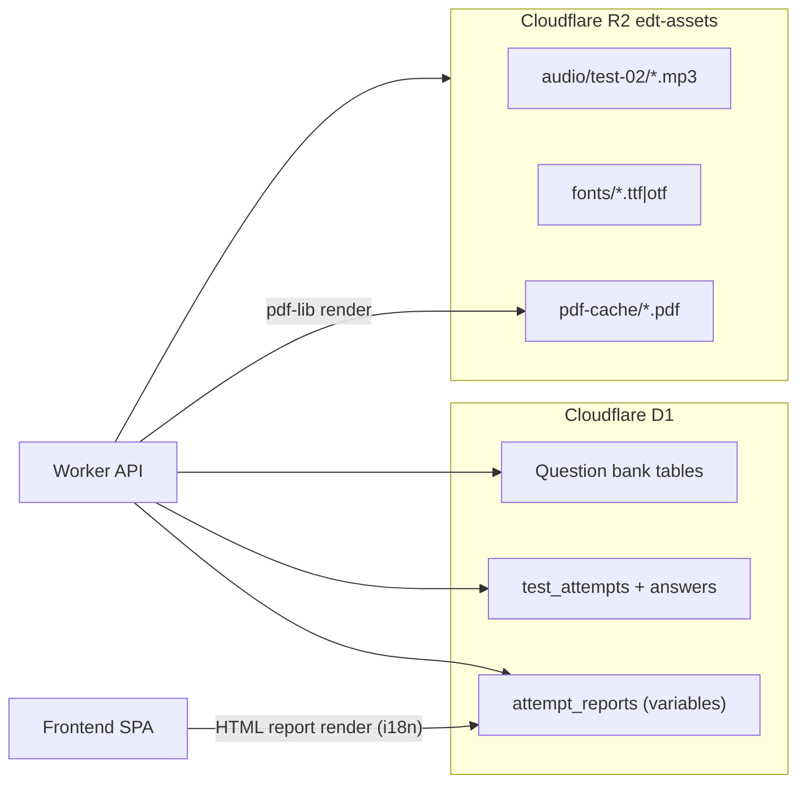
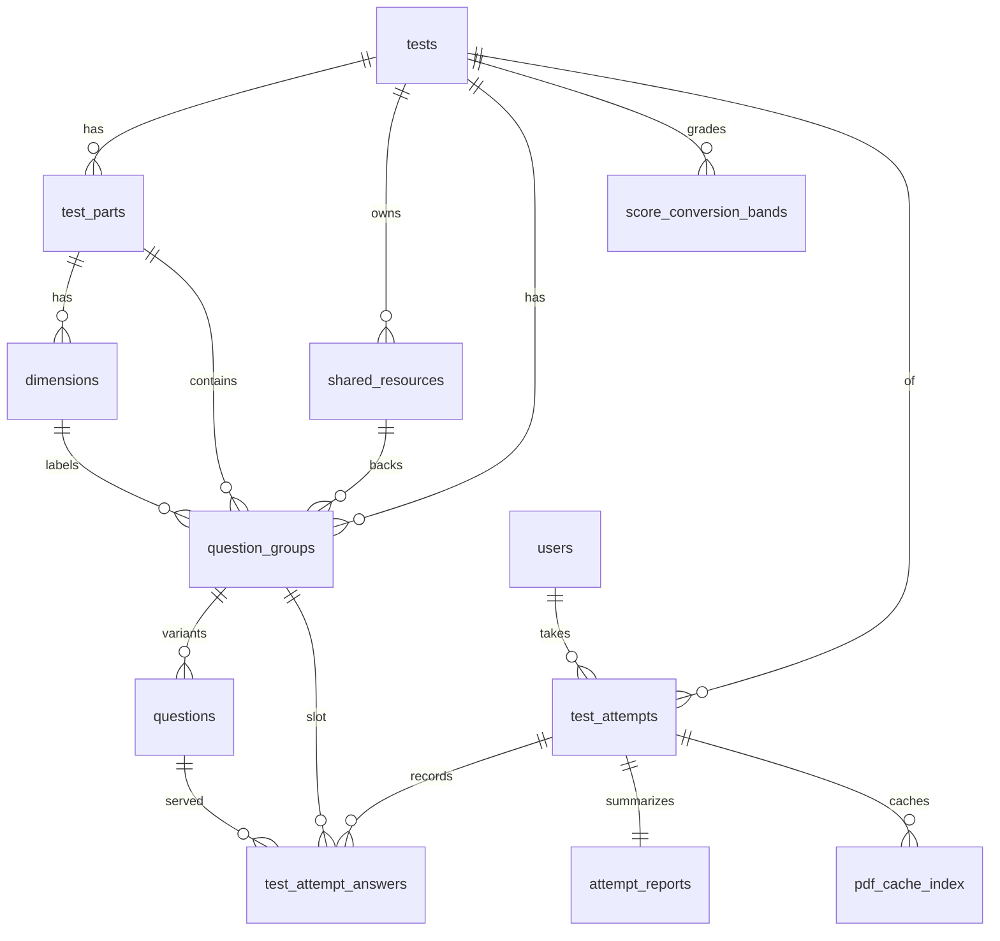
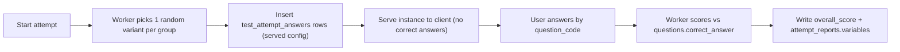
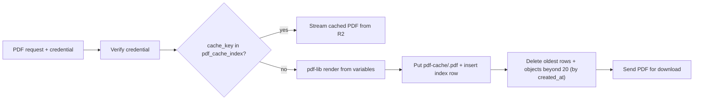

# EDT Database Guide (Unified Test Bank)

This document is the **source of truth for the Cloudflare D1 database schema** of the English Diagnostic Test platform: the unified multi-test question bank, the randomization engine data model, attempt tracking, feedback (report) storage, and the server-side PDF cache.

Related docs:

- [`TEST_BANK_GUIDE.md`](TEST_BANK_GUIDE.md) — question content model, scoring rules, seeding workflows.
- [`AGENTS.md`](AGENTS.md) — UI/branding rules and agent instructions.

---

## 1. Architecture overview

As of schema v4 (migration `0006_unified_test_bank.sql`), **the question bank lives in Cloudflare D1**, not in frontend TypeScript files. The database is the system of record for:

1. **Test content** — tests, parts, dimensions, shared resources (audio/text), question groups, and question variants.
2. **Randomization** — every exam "slot" is a *question group*; each group holds up to 10 *variants*. A test instance is formed by picking exactly one variant per group.
3. **Attempt tracking** — the exact variant served to each user, their answer, and correctness (`test_attempt_answers`).
4. **Feedback storage** — layout-free report variables (`attempt_reports`) rendered to HTML by the frontend and to PDF by the Worker.
5. **Operational data** — vouchers, sessions, teacher credentials (legacy tables, unchanged).



### Scoring moves server-side

The Worker selects variants, serves the test instance, scores answers against `questions.correct_answer`, and writes `test_attempt_answers` + `attempt_reports`. The frontend renders reports from stored variables; it does not own the answer key.

> Migration status: the legacy Test 1 flow (client-side scoring, `submissions` table) remains live until the Worker quiz-flow rewiring stage. Historical `submissions` rows will be migrated into `test_attempts` / `test_attempt_answers` / `attempt_reports` in a later stage using the `db_backup/` export and `question_groups.legacy_qid`.

---

## 2. Question ID business key: `TT-PP-SS-GGG-QQ`

Every question variant has a unique string code stored in `questions.question_code`, used for querying, display, and answer records.

| Segment | Width | Meaning | Values |
|---------|-------|---------|--------|
| `TT` | 2 | Test ID | `01` = Test 1 (Grammar & Vocabulary), `02` = Paper II (Listening & Reading), `03` = Paper III (Speaking & Writing) |
| `PP` | 2 | Part ID | `01` = Part A, `02` = Part B |
| `SS` | 2 | Sub-part / dimension code | `01`–`12` = Test 1 grammar dimensions; `01` = B2 items, `02` = C1/C2 items (Test 2); `00` = no dimension |
| `GGG` | 3 | Question group ID, **global per test** by canonical number | Test 1: `001`–`090`; Test 2: `001`–`045` |
| `QQ` | 2 | Variant ID within the group | `01`–`10` |

Examples:

| Code | Meaning |
|------|---------|
| `01-01-01-007-01` | Test 1, Part A, dimension 01 (Tenses), group 007 (legacy `A7`), variant 01 |
| `01-02-00-073-01` | Test 1, Part B (no dimension), group 073 (legacy `B13`), variant 01 |
| `02-01-01-001-01` | Test 2, Part A Listening, B2 item, group 001 (Q1), variant 01 |
| `02-02-02-031-01` | Test 2, Part B Reading, C1/C2 item, group 031 (Q31), variant 01 |

Rules:

- `GGG` equals the zero-padded `question_groups.canonical_number` and is unique per test (across parts).
- `question_code` is denormalized onto `test_attempt_answers.question_code` so answer history is self-describing even if joins change.
- Codes are **immutable** once attempts exist. Never renumber; add new groups/variants instead.

---

## 3. Entity-relationship overview



---

## 4. Table reference

All DDL lives in [`migrations/0006_unified_test_bank.sql`](migrations/0006_unified_test_bank.sql). Integer autoincrement primary keys are internal; the `question_code` string is the business key. Timestamps are Unix epoch milliseconds (matching the legacy tables).

### 4.1 `tests`

Overarching test/paper.

| Column | Type | Notes |
|--------|------|-------|
| `id` | INTEGER PK AUTOINCREMENT | |
| `test_code` | TEXT UNIQUE NOT NULL | `TT` segment (`'01'`, `'02'`) |
| `name` | TEXT NOT NULL | e.g. "Paper II — Listening & Reading" |
| `description` | TEXT | Introduction copy source |
| `time_limit_seconds` | INTEGER | 3600 for both current tests |
| `status` | TEXT NOT NULL DEFAULT `'draft'` | `draft` / `active` / `archived` |
| `created_at` | INTEGER NOT NULL | |

### 4.2 `test_parts`

Part A / Part B delineation per test.

| Column | Type | Notes |
|--------|------|-------|
| `id` | INTEGER PK AUTOINCREMENT | |
| `test_id` | INTEGER NOT NULL FK → `tests.id` | |
| `part_code` | TEXT NOT NULL | `PP` segment |
| `name` | TEXT NOT NULL | e.g. "Part A — Listening" |
| `skill` | TEXT | `grammar` / `vocabulary` / `listening` / `reading` |
| `sort_order` | INTEGER NOT NULL DEFAULT 0 | |
| | | UNIQUE(`test_id`, `part_code`) |

### 4.3 `dimensions`

Performance dimensions (Test 1: 12 grammar dimensions) or CEFR difficulty groupings (Test 2: B2 vs C1/C2). Scoped to a part.

| Column | Type | Notes |
|--------|------|-------|
| `id` | INTEGER PK AUTOINCREMENT | |
| `test_part_id` | INTEGER NOT NULL FK → `test_parts.id` | |
| `dimension_code` | TEXT NOT NULL | `SS` segment (`'01'`…; `'00'` is the *no-dimension sentinel used in codes only* — no row exists for it) |
| `key` | TEXT NOT NULL | Stable slug. Test 1 keys are verbatim from the legacy `dimensions.ts` (`tenses`, `adjectiveClauses`, …) for submission-history compatibility. **Never rename.** |
| `name` | TEXT NOT NULL | Full label |
| `short` | TEXT | Radar/chart label |
| `sort_order` | INTEGER NOT NULL DEFAULT 0 | |
| | | UNIQUE(`test_part_id`, `dimension_code`) |

### 4.4 `shared_resources`

Multimedia/text assets shared by one or more question groups (Test 2: reading passages and MP3 audio).

| Column | Type | Notes |
|--------|------|-------|
| `id` | INTEGER PK AUTOINCREMENT | |
| `test_id` | INTEGER FK → `tests.id` | Nullable for cross-test assets |
| `resource_type` | TEXT NOT NULL | `audio` / `text` / `image` |
| `title` | TEXT | |
| `content_url` | TEXT | Authenticated Worker route for binary assets, e.g. `/api/assets/audio/test-02/20260701_01.mp3` |
| `text_content` | TEXT | Reading passage text, or the transcript for audio resources |
| `metadata` | TEXT | JSON: `{ "file", "genre", "skill"/"skills", "attribution", "lineNumbers" }` |
| `created_at` | INTEGER NOT NULL | |

Audio binaries live in the R2 bucket `edt-assets` under `audio/test-02/`; `content_url` stores the Worker route, never a public R2 URL (see section 8).

### 4.5 `question_groups`

The exam "slots". Test 1 has 90; Test 2 has 45. A test instance picks one variant per group.

| Column | Type | Notes |
|--------|------|-------|
| `id` | INTEGER PK AUTOINCREMENT | |
| `test_id` | INTEGER NOT NULL FK → `tests.id` | Denormalized so `group_code` can be unique per test across parts |
| `test_part_id` | INTEGER NOT NULL FK → `test_parts.id` | |
| `dimension_id` | INTEGER FK → `dimensions.id` | NULL = overall-only (`SS='00'`) |
| `shared_resource_id` | INTEGER FK → `shared_resources.id` | NULL when the group needs no asset |
| `group_code` | TEXT NOT NULL | `GGG` segment, zero-padded canonical number |
| `canonical_number` | INTEGER NOT NULL | Global order within the test |
| `legacy_qid` | TEXT | `'A7'` / `'B13'` — Test 1 only, used to migrate historical `submissions` |
| `variant_count` | INTEGER NOT NULL DEFAULT 1 | Kept in sync with `questions` rows; target is 10 |
| `sort_order` | INTEGER NOT NULL DEFAULT 0 | |
| | | UNIQUE(`test_id`, `group_code`) |

### 4.6 `questions` (the variants)

The actual MCQs. Exactly four options.

| Column | Type | Notes |
|--------|------|-------|
| `id` | INTEGER PK AUTOINCREMENT | |
| `question_group_id` | INTEGER NOT NULL FK → `question_groups.id` | |
| `question_code` | TEXT UNIQUE NOT NULL | `TT-PP-SS-GGG-QQ` |
| `variant_code` | TEXT NOT NULL | `QQ` segment (`'01'`–`'10'`) |
| `prompt_text` | TEXT NOT NULL | Question stem |
| `option_a` … `option_d` | TEXT NOT NULL | Option texts |
| `correct_answer` | TEXT NOT NULL | `'A'`/`'B'`/`'C'`/`'D'` |
| `explanation` | TEXT | Optional rationale (not currently shown to students) |
| `created_at` | INTEGER NOT NULL | |
| | | UNIQUE(`question_group_id`, `variant_code`) |

### 4.7 `users`

Standard user table. There is **no login UI** yet: identity maps from the voucher/session flow via `external_ref` = voucher code.

| Column | Type | Notes |
|--------|------|-------|
| `id` | INTEGER PK AUTOINCREMENT | |
| `external_ref` | TEXT UNIQUE | Voucher code today; reserved for account IDs later |
| `display_name` | TEXT | Candidate name from the info screen |
| `email` | TEXT | |
| `user_group` | TEXT | Copied from the voucher for teacher scoping |
| `education_level` | TEXT | |
| `created_at` | INTEGER NOT NULL | |

### 4.8 `test_attempts`

One row per test run.

| Column | Type | Notes |
|--------|------|-------|
| `id` | TEXT PK | UUID |
| `user_id` | INTEGER FK → `users.id` | |
| `test_id` | INTEGER NOT NULL FK → `tests.id` | |
| `session_token` | TEXT | Links to legacy `sessions` |
| `start_time` | INTEGER | |
| `end_time` | INTEGER | |
| `status` | TEXT NOT NULL DEFAULT `'in-progress'` | `in-progress` / `completed` |
| `overall_score` | INTEGER | Correct count |
| `created_at` | INTEGER NOT NULL | |

### 4.9 `test_attempt_answers`

The exact randomized configuration and responses — one row per group per attempt, recording **which variant was served**.

| Column | Type | Notes |
|--------|------|-------|
| `id` | INTEGER PK AUTOINCREMENT | |
| `test_attempt_id` | TEXT NOT NULL FK → `test_attempts.id` | |
| `question_group_id` | INTEGER NOT NULL FK → `question_groups.id` | The slot |
| `question_id` | INTEGER NOT NULL FK → `questions.id` | The served variant |
| `question_code` | TEXT NOT NULL | Denormalized `TT-PP-SS-GGG-QQ` |
| `selected_option` | TEXT | `'A'`–`'D'`, NULL = unanswered |
| `is_correct` | INTEGER | `0`/`1`, NULL until scored |
| `answered_at` | INTEGER | |
| | | UNIQUE(`test_attempt_id`, `question_group_id`) |

### 4.10 `attempt_reports`

Layout-free feedback variables (see section 7). One row per attempt.

| Column | Type | Notes |
|--------|------|-------|
| `id` | INTEGER PK AUTOINCREMENT | |
| `test_attempt_id` | TEXT UNIQUE NOT NULL FK → `test_attempts.id` | |
| `report_version` | TEXT NOT NULL | Variables schema version (`'rv1'`) |
| `variables` | TEXT NOT NULL | Pure JSON variables — **no HTML, no layout, no locale-baked narrative strings** |
| `created_at` | INTEGER NOT NULL | |

### 4.11 `score_conversion_bands`

Data-driven CEFR/IELTS/TOEFL conversion grids, replacing hardcoded band tables.

| Column | Type | Notes |
|--------|------|-------|
| `id` | INTEGER PK AUTOINCREMENT | |
| `test_id` | INTEGER NOT NULL FK → `tests.id` | |
| `test_part_id` | INTEGER FK → `test_parts.id` | NULL = overall band (Test 1 model); set = per-part band (Test 2 model) |
| `min_correct` / `max_correct` | INTEGER NOT NULL | Inclusive raw-score range |
| `band_key` | TEXT NOT NULL | Stable slug for i18n narratives (e.g. `c1`, `highB2LowC1`). **Never rename.** |
| `cefr_label` | TEXT NOT NULL | `'≤A2'`, `'B1/B1+'`, `'C1+/C2'`, … |
| `ielts_indicative` | TEXT | e.g. `'~7.5–8.0'` |
| `toefl_indicative` | TEXT | e.g. `'C1 (~90–105 / 120)'` |
| `sort_order` | INTEGER NOT NULL DEFAULT 0 | |

Test 1 uses one overall grid (0–90). Test 2 uses per-part grids (Listening /20, Reading /25) plus the averaging rule: *both parts ≥ C1 → overall C1/C2; one B2 + one C1 → high B2/low C1; both B2 → B2* (implemented in Worker scoring logic, per the client conversion notes).

### 4.12 `voucher_test_usage`

Per-test voucher consumption (migration `0009`). `vouchers.uses_allowed` means allowed attempts **per test**: one voucher covers Test 1 and Test 2, each up to N submissions. `vouchers.use_count` remains the cross-test total for admin display. Usage is consumed at **submit** time (not at login).

| Column | Type | Notes |
|--------|------|-------|
| `voucher_code` | TEXT NOT NULL FK → `vouchers.code` | |
| `test_id` | INTEGER NOT NULL FK → `tests.id` | |
| `use_count` | INTEGER NOT NULL DEFAULT 0 | Gate: `use_count < vouchers.uses_allowed` |
| | | PRIMARY KEY (`voucher_code`, `test_id`) |

Historical usage was seeded as Test 1 rows from `vouchers.use_count`.

### 4.13 `pdf_cache_index`

FIFO index for cached report PDFs stored in R2 (see section 8.2).

| Column | Type | Notes |
|--------|------|-------|
| `cache_key` | TEXT PK | `attemptId:lang:reportVersion` |
| `test_attempt_id` | TEXT NOT NULL FK → `test_attempts.id` | |
| `r2_key` | TEXT NOT NULL | e.g. `pdf-cache/<attemptId>-<lang>-rv1.pdf` |
| `size_bytes` | INTEGER | |
| `created_at` | INTEGER NOT NULL | Eviction order (first-come-first-leave) |

### Indexes

```sql
CREATE INDEX idx_question_groups_test           ON question_groups(test_id);
CREATE INDEX idx_question_groups_part           ON question_groups(test_part_id);
CREATE INDEX idx_question_groups_dimension      ON question_groups(dimension_id);
CREATE INDEX idx_question_groups_resource       ON question_groups(shared_resource_id);
CREATE INDEX idx_questions_group                ON questions(question_group_id);
CREATE INDEX idx_shared_resources_test          ON shared_resources(test_id);
CREATE INDEX idx_test_attempts_user             ON test_attempts(user_id);
CREATE INDEX idx_test_attempts_test             ON test_attempts(test_id);
CREATE INDEX idx_test_attempts_status           ON test_attempts(status);
CREATE INDEX idx_attempt_answers_attempt        ON test_attempt_answers(test_attempt_id);
CREATE INDEX idx_attempt_answers_question       ON test_attempt_answers(question_id);
CREATE INDEX idx_attempt_answers_code           ON test_attempt_answers(question_code);
CREATE INDEX idx_conversion_bands_test_part     ON score_conversion_bands(test_id, test_part_id);
CREATE INDEX idx_pdf_cache_created              ON pdf_cache_index(created_at);
```

---

## 5. Legacy tables (unchanged)

| Table | Purpose | Future |
|-------|---------|--------|
| `vouchers` | Access codes + cohort metadata (`uses_allowed` is now **per test**, see 4.12) | Stays; feeds `users.external_ref` |
| `sessions` | Active quiz sessions | Stays; `test_attempts.session_token` links here |
| `submissions` | Legacy Test 1 reports (JSON payload + denormalized scores) | Read-only after history migration into `test_attempts`/`attempt_reports` |
| `teacher_credentials` | Teacher dashboard access | Stays |

The pre-restructure production snapshot lives in `db_backup/` (gitignored): `edt-diagnostic-20260707.sql` (56 vouchers, 42 sessions, 27 submissions, 4 teacher credentials at export time).

---

## 6. Randomization engine and attempt flow



Contract (**implemented** in [`worker/src/attempts.ts`](worker/src/attempts.ts); used by Test 2 — Test 1 remains on the legacy client-scored flow):

1. `POST /api/attempts` `{ testCode, candidateInfo }` (Bearer session) — gates on remaining `voucher_test_usage`, upserts `users` (`external_ref` = voucher code), creates `test_attempts` (in-progress), picks one random variant per group, inserts one `test_attempt_answers` row per group with `selected_option = NULL`, and returns the instance: prompt/options + resource payloads. Audio resources return only the authenticated route URL — **never** the transcript; `correct_answer` never leaves the server before submit.
2. `POST /api/attempts/:id/answers` `{ questionCode, selectedOption }` — incremental save keyed by `question_code` (never display index); owner session only.
3. `POST /api/attempts/:id/submit` `{ candidateInfo, autoSubmitted }` — consumes one per-test voucher use (409 when exhausted), scores server-side (`is_correct`), computes part scores + bands from `score_conversion_bands`, derives the overall band (overall grid when present; otherwise the part-band averaging rule from the client conversion notes), sets `overall_score` / `end_time` / `status='completed'`, writes `attempt_reports` (`rv1`), and returns `{ variables, review }` (review includes correct answers — safe post-submit). Idempotent: a second submit returns the stored report.
4. `GET /api/attempts/:id/report` — same payload for re-viewing; accepts the report credentials (owning session, `?voucher=` retrieval pair, or group-scoped teacher key).

---

## 7. Feedback storage: report variables (`rv1`)

`attempt_reports.variables` stores **pure data variables** — no layout, markup, or locale-rendered text. Both renderers consume the same row:

- **Frontend HTML view** — student/teacher report pages resolve narratives from the i18n dictionaries (`report.*`, keyed by `levelKey`/`bandKey`) at render time, so one stored report can display in EN or zh-HK.
- **Worker PDF** — `GET /api/reports/:attemptId/pdf` renders with pdf-lib from the same variables (section 8.2).

### Schema (TypeScript shape, versioned as `rv1`)

```ts
type ReportVariablesV1 = {
  testCode: string;                       // '01' | '02'
  candidate: {
    name: string;
    ref: string;                          // candidate-entered ID
    userGroup: string;
    educationLevel: string | null;
  };
  attempt: {
    attemptId: string;
    startTime: number;                    // epoch ms
    endTime: number;
    durationSec: number;
    autoSubmitted: boolean;
  };
  scores: {
    overall: { correct: number; total: number };
    parts: Array<{ partCode: string; skill: string; correct: number; total: number }>;
  };
  dimensions: Array<{                     // empty for tests without dimension scoring
    key: string;                          // stable slug ('tenses', ...)
    dimensionCode: string;                // SS ('01'...)
    partCode: string;
    score: number;
    max: number;
    levelKey: 'needsWork' | 'developing' | 'good' | 'strong' | 'excellent';
  }>;
  bands: {
    overall: BandRef | null;              // Test 1: from the overall grid; Test 2: averaged per the conversion rule
    parts: Array<BandRef & { partCode: string }>; // Test 2: per-part CEFR bands; empty for Test 1
  };
  weakDimensionKeys: string[];            // dimension keys with levelKey needsWork/developing
  cohort: {                               // percentile snapshot at submit time
    percentileRank: number | null;
    cohortRank: number | null;
    cohortSize: number;
    cohortMean: number | null;
    groupPercentileRank: number | null;
    groupCohortRank: number | null;
    groupCohortSize: number;
    groupCohortMean: number | null;
  } | null;
};

type BandRef = {
  bandKey: string;                        // score_conversion_bands.band_key
  cefrLabel: string;                      // denormalized for resilience
  ielts: string | null;
  toefl: string | null;
};
```

Per-question outcomes are **not** duplicated into the JSON — they live in `test_attempt_answers`.

### Mapping from the legacy `ReportResult` (Test 1 history migration)

| Legacy `submissions.payload` field | `rv1` target |
|------------------------------------|--------------|
| `candidateInfo.name` / `.id` / `.userGroup` | `candidate.name` / `.ref` / `.userGroup` |
| `startedAt` / `submittedAt` / `durationSec` / `autoSubmitted` | `attempt.*` |
| `scores.partA` / `scores.partB` | `scores.parts[]` (`partCode` `'01'`/`'02'`; `pct` recomputable, dropped) |
| `scores.total` | `scores.overall` |
| `dimensions[]` (`key`, `score`, `levelKey`) | `dimensions[]` (+ `dimensionCode`, `max: 5`) |
| `cefrBand` (`cefr`, `ielts`, `toefl`) | `bands.overall` (`bandKey` looked up in `score_conversion_bands`) |
| `reportSnapshot.weakDimensions` | `weakDimensionKeys` |
| `reportSnapshot.questionCorrectness` | `test_attempt_answers` rows (via `legacy_qid` → group/variant) |
| `backendData` | `cohort` |
| `cefrBand.headline/description/recommendation` (rendered text) | **dropped** — resolved from i18n by `bandKey` at render time |

---

## 8. R2 assets and the PDF service

One R2 bucket, `edt-assets`, bound to the Worker as `R2_ASSETS`:

| Prefix | Contents |
|--------|----------|
| `audio/test-02/` | 20 listening MP3s (`20260701_01.mp3` … `20260701_20.mp3`) |
| `fonts/` | PDF fonts fetched at render time: `Montserrat-Regular.ttf`, `Montserrat-SemiBold.ttf`, `NotoSerifTC-Regular.ttf` (TrueType-outline variable font — fontkit can subset it, unlike the Noto CJK OTFs) |
| `pdf-cache/` | Cached report PDFs (max 20, FIFO) |

Populate with `scripts/upload-assets.ps1` (remote R2 must be enabled on the Cloudflare account first; add `-Local` for the wrangler dev simulation).

### 8.1 Authenticated audio streaming

`GET /api/assets/audio/<path>` (Worker route, `worker/src/assets.ts`):

- Requires a **valid active session** (`Authorization: Bearer <sessionToken>`) or a **teacher key** (`X-Teacher-Key`).
- Streams the R2 object with `Content-Type: audio/mpeg`; supports `Range` requests for seeking.
- Objects are never publicly listable or directly reachable — `shared_resources.content_url` stores only this route.

### 8.2 Server-side PDF rendering + FIFO cache

`GET /api/reports/:attemptId/pdf?lang=en|zh-HK` (Worker route, `worker/src/reports.ts`):

**Auth (any one):**

1. Student retrieval pair: `?voucher=<code>` matching `users.external_ref` of the attempt's user.
2. Active session Bearer token equal to `test_attempts.session_token`.
3. Teacher key whose `user_group` matches the attempt user's `user_group`.

**Rendering:** pdf-lib + `@pdf-lib/fontkit`; EDT-branded template (palette/typography per `AGENTS.md`); fonts loaded from R2 `fonts/` and embedded with subsetting; all text assembled from `attempt_reports.variables` + `test_attempt_answers` + the i18n string table. Response is `application/pdf` with `Content-Disposition: attachment` for direct download.

**Cache protocol (first-come-first-leave, max 20):**



Eviction is strictly by insertion order (`created_at` ascending), not last access.

---

## 9. Seeded content summary

### Test 1 (`test_code='01'`, migration `0007_seed_test1.sql`)

| Entity | Rows | Notes |
|--------|------|-------|
| `test_parts` | 2 | `01` Part A Applied Grammar, `02` Part B Vocabulary |
| `dimensions` | 12 | Part A only; `key`/`name`/`short` verbatim from legacy `dimensions.ts` |
| `question_groups` | 90 | `group_code` = zero-padded canonical 001–090; `legacy_qid` `A1`–`A60`, `B1`–`B30`; `variant_count=1` |
| `questions` | 90 | Variant `01` per group, content from the legacy `questions.ts` + `ANSWER_KEY` |
| `shared_resources` | 0 | |
| `score_conversion_bands` | 5 | Overall grid 0–90 (≤A2 / B1 / B2 / C1 / C2), from legacy `cefr.ts` |

### Test 2 (`test_code='02'`, migration `0008_seed_test2.sql`)

| Entity | Rows | Notes |
|--------|------|-------|
| `test_parts` | 2 | `01` Part A Listening (20 Qs), `02` Part B Reading (25 Qs) |
| `dimensions` | 4 | Per part: `01` = B2 items, `02` = C1/C2 items |
| `shared_resources` | 26 | 20 audio (with transcripts) + 6 reading passages |
| `question_groups` | 45 | `group_code` 001–045 global; Part A = 001–020, Part B = 021–045 |
| `questions` | 45 | Variant `01` per group, transcribed from the Paper II Test v2 docx |
| `score_conversion_bands` | 11 | Part A grid /20 (5 bands) + Part B grid /25 (6 bands), from the corrected conversion notes |

Question numbering note: the source docx headed the forestry passage "Questions 31–36" but contains seven stems; per client confirmation Part B has **25 questions numbered 21–45 continuously** (forestry = Q31–37, Creative Commons = Q38–45).

Dimension tagging: Part A Q1–6 = B2, Q7–20 = C1/C2; Part B Q21–30 = B2, Q31–45 = C1/C2 (per the Design and Overview doc).

---

## 10. Operational notes

- **Migrations:** `npx wrangler d1 migrations apply edt-diagnostic --local` (dev) / `--remote` (production). Migrations are tracked in `d1_migrations`; never edit an applied migration — add a new one.
- **Backups:** `npx wrangler d1 export edt-diagnostic --remote --output db_backup/edt-diagnostic-<date>.sql`. Always back up before schema changes.
- **Content changes** (new variants, new tests) ship as new seed migrations. Validate with the invariants checklist in [`TEST_BANK_GUIDE.md`](TEST_BANK_GUIDE.md).
- **Secrets:** no voucher batches, tokens, or credentials belong in this repo. The D1 `database_id` lives only in `wrangler.toml`.
