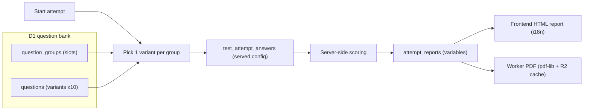

# EDT Test Bank Guide

This document is the source of truth for **question content, scoring models, and CEFR mapping** on the English Diagnostic Test platform. Read it before adding, removing, or remapping MCQs — especially when using an LLM to assist.

For the database schema itself, see [`DATABASE_README.md`](DATABASE_README.md). For UI and branding rules, see [`AGENTS.md`](AGENTS.md).

---

## 1. Architecture and scope

### The question bank lives in Cloudflare D1

As of schema v4 (migration `0006_unified_test_bank.sql`), MCQ content is stored **in the D1 database** — not in frontend TypeScript files. D1 is the system of record for:

| Content | D1 tables |
|---------|-----------|
| Tests, parts, dimensions | `tests`, `test_parts`, `dimensions` |
| Question groups (exam "slots") and variants | `question_groups`, `questions` |
| Shared passages / audio | `shared_resources` (binaries in R2 `edt-assets`) |
| CEFR / IELTS / TOEFL conversion grids | `score_conversion_bands` |
| Attempts, served variants, answers | `test_attempts`, `test_attempt_answers` |
| Report variables (layout-free) | `attempt_reports` |
| PDF cache index | `pdf_cache_index` |

Question content ships as **seed migrations** (`migrations/0007_seed_test1.sql`, `0008_seed_test2.sql`), generated by scripts:

- `scripts/generate-test1-seed.mjs` — reads the legacy `frontend/src/data/*.ts` files.
- `scripts/generate-test2-seed.mjs` — reads `scripts/test2-content.mjs` (transcribed from the client's Paper II docx files).

> **Transition note:** the live **Test 1** quiz flow still reads `frontend/src/data/questions.ts` and scores client-side, writing to the legacy `submissions` table. Until Test 1 moves to the attempts API, any Test 1 content fix must be applied in **both** `frontend/src/data/` and a new D1 seed migration. **Test 2 is fully DB-backed and live**: it runs on the attempts API (`worker/src/attempts.ts` — random variant serving, server-side scoring, `attempt_reports`), with the test picker on the info screen and per-test voucher usage (`voucher_test_usage`, migration `0009`).

### The randomization engine model

Every exam "slot" is a **question group**. Each group holds up to **10 variants** (the actual MCQs). When a user starts a test, the Worker randomly selects **exactly one variant per group** to form their unique test instance, records the served configuration in `test_attempt_answers`, scores server-side against `questions.correct_answer`, and stores layout-free report variables in `attempt_reports`.



Currently every group has **1 variant** (`QQ='01'`); the remaining 9 variants per group are authored in a later stage. The engine must keep working for any `variant_count` from 1 to 10.

---

## 2. Question ID code: `TT-PP-SS-GGG-QQ`

Every variant has a unique `question_code` (see [`DATABASE_README.md`](DATABASE_README.md) section 2 for the full spec):

- `TT` test (`01`, `02`) · `PP` part (`01` A, `02` B) · `SS` dimension (`00` = none) · `GGG` group (global per test, zero-padded canonical number) · `QQ` variant (`01`–`10`).
- Example: `02-01-02-007-01` = Test 2, Part A Listening, C1/C2 item, group 007, variant 01.
- **Score by `question_code` / group, never by shuffled display index.**
- Codes are immutable once attempts exist. Add new groups/variants; never renumber.

---

## 3. Current test models

### Test 1 — Grammar & Vocabulary (`test_code='01'`, status `active`)

| Concept | Value |
|---------|-------|
| Total question groups | **90** (`GGG` 001–090) |
| Part A (`PP='01'`, grammar) | 60 groups, canonical 1–60, legacy IDs `A1`–`A60` |
| Part B (`PP='02'`, vocabulary) | 30 groups, canonical 61–90, legacy IDs `B1`–`B30` |
| Dimensions | **12** grammar dimensions (Part A only), `SS` `01`–`12`, 5 groups each |
| Part B dimension | none (`SS='00'`, `dimension_id` NULL) |
| Time limit | 3600 s |
| Conversion grid | overall 0–90 (`test_part_id` NULL): ≤A2 0–26, B1 27–40, B2 41–56, C1 57–74, C2 75–90 |
| Band keys | `a2below`, `b1`, `b2`, `c1`, `c2` |

Dimension slugs (`dimensions.key`) are verbatim from the legacy `dimensions.ts` — `tenses`, `adjectiveClauses`, `nounClauses`, `adverbialClausesReasons`, `adverbialClausesMannerTimePlace`, `adverbialClausesConcession`, `conditionals`, `activePassive`, `gerundsInfinitives`, `reportedSpeech`, `collocationsPrepositions`, `subjectVerbAgreement` — because historical `submissions.dimension_scores` JSON is keyed by them. **Never rename.**

Per-dimension level (5 groups per dimension): 0–1 correct → `needsWork`, 2 → `developing`, 3 → `good`, 4 → `strong`, 5 → `excellent`. Weak dimensions = level ≤ 2.

### Test 2 — Paper II Listening & Reading (`test_code='02'`, status `active`)

| Concept | Value |
|---------|-------|
| Total question groups | **45** (`GGG` 001–045) |
| Part A (`PP='01'`, listening) | 20 groups (Q1–20), each linked to one audio resource |
| Part B (`PP='02'`, reading) | 25 groups (Q21–45), linked to 6 shared passages |
| Dimensions | CEFR difficulty bands per part: `SS='01'` = B2 items, `SS='02'` = C1/C2 items |
| Difficulty tagging | Part A: Q1–6 B2, Q7–20 C1/C2 · Part B: Q21–30 B2, Q31–45 C1/C2 |
| Time limit | 3600 s |
| Audio | R2 `audio/test-02/20260701_NN.mp3`, streamed via authenticated `/api/assets/audio/...`; transcripts stored in `shared_resources.text_content` |
| Passages | 6 `text` resources: narrative (Q21–22), seminar notice (Q23–25), LabelPro (Q26–27), Macrosoft letter (Q28–30), forestry (Q31–37), Creative Commons (Q38–45) |

**Numbering note:** the source docx headed the forestry passage "Questions 31–36" but contains seven stems; the client confirmed Part B has **25 questions numbered 21–45 continuously** (forestry = Q31–37, Creative Commons = Q38–45) and corrected the conversion-notes docx to /25.

Per-part conversion grids (`score_conversion_bands`, from the corrected client conversion notes):

| Part A /20 | Band (`band_key`) | | Part B /25 | Band (`band_key`) |
|------------|-------------------|-|------------|-------------------|
| 0–7 | B1/B1+ (`b1Plus`) | | 0–9 | B1/B1+ (`b1Plus`) |
| 8–11 | Low B2 (`lowB2`) | | 10–13 | Low B2 (`lowB2`) |
| 12–14 | High B2 / Low C1 (`highB2LowC1`) | | 14–16 | High B2 / Low C1 (`highB2LowC1`) |
| 15–17 | C1 (`c1`) | | 17–19 | C1 (`c1`) |
| 18–20 | C1+/C2 (`c1PlusC2`) | | 20–22 | C1+/near C2 (`c1PlusNearC2`) |
| | | | 23–25 | C2 (`c2`) |

Overall level = average of the two part bands: both ≥ C1 → overall C1/C2; one B2 + one C1 → high B2/low C1; both B2 → B2. Present all mappings as **indicative**, never exact (see the proficiency disclaimer in i18n).

---

## 4. Feedback and reports

- `attempt_reports.variables` stores **pure variables only** (version `rv1`, TypeScript shape in `worker/src/reportVariables.ts`, spec in [`DATABASE_README.md`](DATABASE_README.md) section 7). No HTML, no layout, no locale-baked narrative text.
- Narratives are resolved at render time from keys: `levelKey` (dimensions), `band_key` (CEFR bands) — frontend i18n dictionaries for the HTML view, `worker/src/reportI18n.ts` for the PDF. **Update both EN and zh-HK in both places.**
- PDF download: `GET /api/reports/:attemptId/pdf?lang=en|zh-HK` (`worker/src/reports.ts`) — pdf-lib render, EDT-branded, cached in R2 (latest 20, FIFO). Auth: voucher retrieval pair, owning session, or teacher key scoped by `user_group`.
- Per-question outcomes live in `test_attempt_answers`, not in the report JSON.

---

## 5. File touchpoint matrix

Update **every** relevant row when content or scoring models change.

| Change | Touchpoints |
|--------|-------------|
| Edit a Test 1 MCQ | New D1 migration updating `questions` **and** (until quiz-flow rewiring) `frontend/src/data/questions.ts` + `ANSWER_KEY`; regenerate via `scripts/generate-test1-seed.mjs` only for fresh databases |
| Edit a Test 2 MCQ / transcript / passage | `scripts/test2-content.mjs` + new D1 migration updating the affected rows |
| Add variants to a group | New migration inserting `questions` rows (`QQ` next free, `UNIQUE(question_group_id, variant_code)`), update `question_groups.variant_count` |
| Add a new audio/text resource | `shared_resources` row + R2 upload via `scripts/upload-assets.ps1`; `content_url` must be an `/api/assets/...` route |
| Change dimensions | `dimensions` table; keep `key` stable (history); Worker teacher-dashboard duplicates (`DIMENSION_KEYS` in `worker/src/index.ts`) until it reads from D1 |
| Change conversion bands | `score_conversion_bands` migration; keep `band_key` stable; sync `SCORE_BUCKETS` in `worker/src/index.ts` (legacy dashboard) and narrative keys in `worker/src/reportI18n.ts` + `frontend/src/i18n/messages.ts` |
| New test | `tests` + parts + dimensions + groups + variants + bands seed migration; status `draft` until UI ships |
| Report variable shape | Bump `report_version`, update `worker/src/reportVariables.ts`, both renderers |
| User-visible counts / copy | `frontend/src/i18n/messages.ts` (EN **and** zh-HK), `USER_GUIDE.md` |

### Legacy duplication warning

Until the Worker quiz-flow stage, these duplicates still exist and must stay in sync for the **legacy Test 1 flow**: `frontend/src/data/questions.ts` / `dimensions.ts` / `cefr.ts`, and in `worker/src/index.ts` the `DIMENSION_KEYS`, `SCORE_BUCKETS`, `ALL_QIDS_ORDERED` constants (teacher dashboard aggregation over legacy `submissions`).

---

## 6. Invariants checklist

Run before merging any test-bank change (SQL against D1):

- [ ] Every `question_code` matches `TT-PP-SS-GGG-QQ` (15 chars, 4 dashes) and is UNIQUE
- [ ] `TT` = `tests.test_code`, `GGG` = `question_groups.group_code`, `SS` = linked `dimensions.dimension_code` (or `00` when `dimension_id` IS NULL) for every variant
- [ ] `UNIQUE(test_id, group_code)` and `UNIQUE(question_group_id, variant_code)` hold; `variant_count` = actual variant rows per group
- [ ] `correct_answer` ∈ {A, B, C, D}; exactly four non-empty options per variant
- [ ] Test 1: 12 dimensions × 5 groups; 90 groups; `legacy_qid` set for all groups
- [ ] Test 2: every listening group has an audio resource; every reading group has a passage; audio `content_url` points to `/api/assets/audio/...` (never a public URL)
- [ ] Conversion bands per (test, part) cover 0…total contiguously with no overlap; top `max_correct` = group count of scope
- [ ] `dimensions.key` and `score_conversion_bands.band_key` unchanged for existing rows (history compatibility)
- [ ] EN and zh-HK strings updated for any user-visible change (frontend i18n + `worker/src/reportI18n.ts`)
- [ ] New content shipped as a **new** migration — applied migrations are never edited
- [ ] Legacy Test 1 flow untouched or synced (`frontend/src/data/` + worker constants) until quiz-flow rewiring ships

---

## 7. Workflows

### Workflow A — Edit an existing variant's text or answer

1. Write a new migration (`migrations/00NN_fix_....sql`) with `UPDATE questions SET ... WHERE question_code = '...'`.
2. If Test 1: mirror the change in `frontend/src/data/questions.ts` (+ `ANSWER_KEY`) while the legacy flow is live.
3. If Test 2: also update `scripts/test2-content.mjs` so regeneration stays faithful.
4. Apply local → verify with the invariants checklist → apply remote (`npx wrangler d1 migrations apply edt-diagnostic --local|--remote`).

### Workflow B — Author additional variants (target: 10 per group)

1. Draft variants matching the group's dimension/difficulty and, for Test 2, the same shared resource.
2. New migration inserting `questions` rows: next `variant_code` (`02`…`10`), `question_code` with the same `TT-PP-SS-GGG` prefix.
3. Update `question_groups.variant_count`.
4. Never delete or renumber existing variants that have been served (they are referenced by `test_attempt_answers`).

### Workflow C — Add a new test

1. Back up remote D1 first (`wrangler d1 export ... --output db_backup/...`).
2. Seed migration: `tests` (next `test_code`), `test_parts`, `dimensions`, `shared_resources` (+ R2 uploads), `question_groups`, `questions`, `score_conversion_bands`.
3. Status `draft` until its UI ships; the randomization engine and PDF service are content-agnostic.
4. Add narrative i18n for any new `band_key`s (frontend + `worker/src/reportI18n.ts`, EN + zh-HK).

### Workflow D — Migrate Test 1 history (later stage, planned)

Historical `submissions` rows → `test_attempts` / `test_attempt_answers` / `attempt_reports` using `question_groups.legacy_qid` (`A7` → group 007) and matching dimension `key`s, sourced from the `db_backup/` export. Until then the teacher dashboard keeps aggregating the legacy `submissions` table.

---

## 8. LLM agent instructions

1. **Read this file and [`DATABASE_README.md`](DATABASE_README.md) first** before touching test content.
2. **Never score by display index** — use `question_code` / stable group identity.
3. **Never hardcode variant selection** — the engine picks one random variant per group at attempt start; the served variant is recorded in `test_attempt_answers`.
4. **Ship content changes as new D1 migrations**; never edit applied migrations; regenerate seeds only for fresh databases.
5. **Keep `dimensions.key` and `band_key` values stable** — stored history and narrative i18n key off them.
6. **Never store layout, HTML, or locale-rendered text in `attempt_reports.variables`** — variables only; narratives resolve from i18n at render time.
7. **Never expose R2 audio publicly** — only through the authenticated `/api/assets/audio/...` route.
8. **Update EN and zh-HK together** (frontend `messages.ts` and `worker/src/reportI18n.ts`).
9. **Sync the legacy Test 1 duplicates** (`frontend/src/data/`, worker constants) until the quiz-flow rewiring stage removes them.
10. **Run the invariants checklist** (section 6) and list every file/table touched in the PR description.

---

## 9. Quick reference — primary sources

```
DATABASE_README.md               ← schema, ID spec, attempts API contract, report variables, PDF/cache protocol
migrations/
  0006_unified_test_bank.sql     ← 12-table unified schema
  0007_seed_test1.sql            ← Test 1 content (generated)
  0008_seed_test2.sql            ← Test 2 content (generated)
  0009_voucher_test_usage.sql    ← per-test voucher usage
  0010_activate_test2.sql        ← Paper II activation
scripts/
  generate-test1-seed.mjs        ← Test 1 seed generator (reads frontend/src/data)
  test2-content.mjs              ← Test 2 content source (transcribed from docx)
  generate-test2-seed.mjs        ← Test 2 seed generator
  upload-assets.ps1              ← R2 uploads: audio + PDF fonts
worker/src/
  index.ts                       ← routes; voucher/session; legacy Test 1 submit + teacher dashboard
  attempts.ts                    ← attempts API: random variant serving, server scoring, reports
  assets.ts                      ← authenticated audio streaming (R2)
  reports.ts                     ← server-side PDF + FIFO cache
  reportVariables.ts             ← rv1 report variables schema
  reportI18n.ts                  ← PDF narrative strings (EN + zh-HK)
frontend/src/
  data/                          ← LEGACY Test 1 static bank (until Test 1 moves to attempts API)
  screens/Test2QuizScreen.tsx    ← Paper II quiz (audio once-only, passage viewer)
  screens/Test2ResultsScreen.tsx ← Paper II report (bands, difficulty bars, server PDF)
  components/AudioOncePlayer.tsx ← once-only listening clip player
  components/PassageViewer.tsx   ← scrollable passage container (remounts per passage)
db_backup/                       ← pre-restructure D1 exports (gitignored)
```
