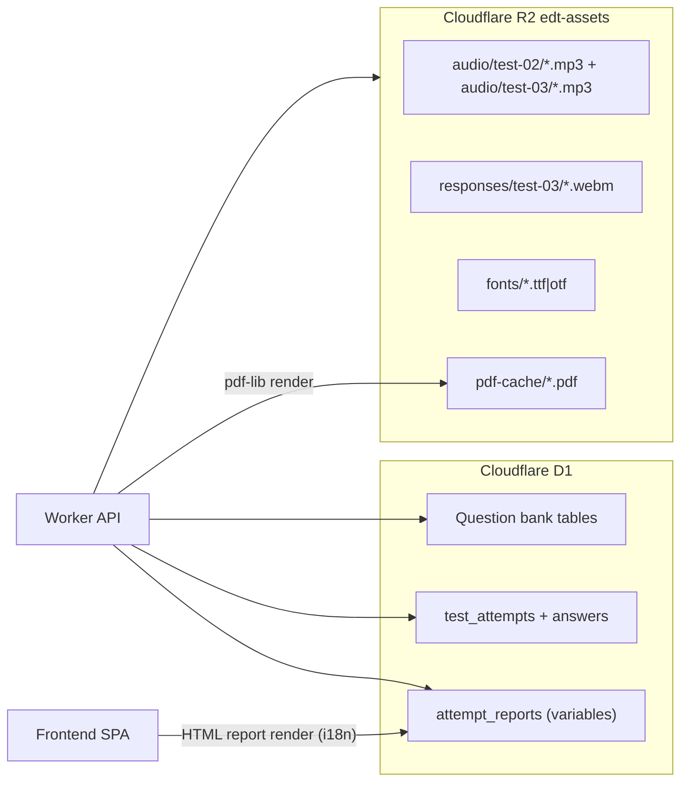
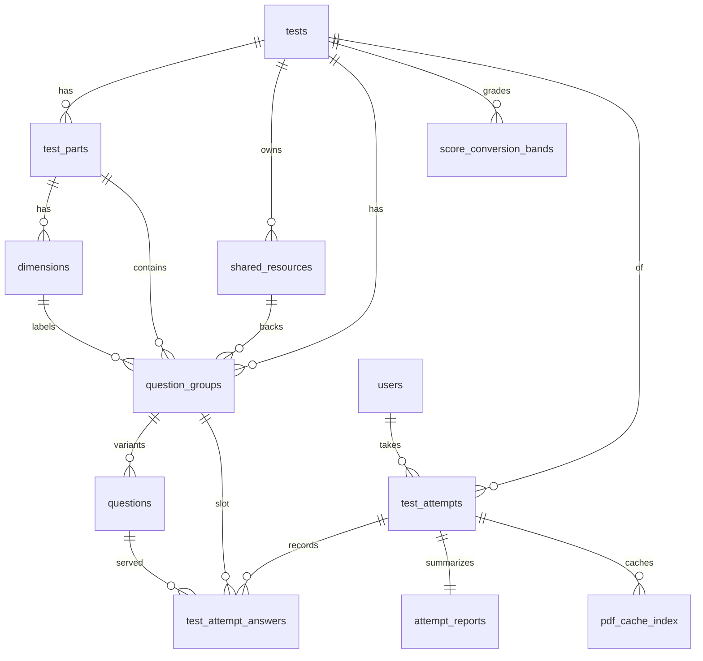
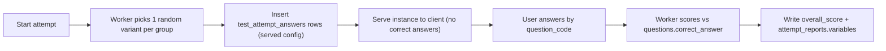
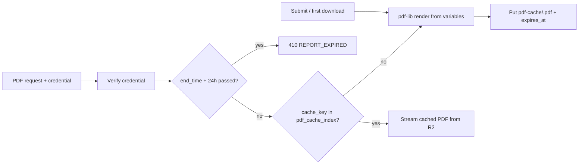

# EDT Database Guide (Unified Test Bank)

This document is the **source of truth for the Cloudflare D1 database schema** of the English Diagnostic Test platform: the unified multi-test question bank, the randomization engine data model, attempt tracking, feedback (report) storage, and the server-side PDF cache.

Related docs:

- [`TEST_BANK_GUIDE.md`](TEST_BANK_GUIDE.md) — question content model, the per-paper scoring and CEFR grids, seeding workflows, and the canonical repository file map.
- [`AGENTS.md`](../AGENTS.md) — UI/branding rules and agent instructions.

**Division of authority:** this document is authoritative for the `TT-PP-SS-GGG-QQ` code
specification, table structures, the `score_conversion_bands` model and band-averaging rule, and
the attempts API contract. `TEST_BANK_GUIDE.md` is authoritative for content: which dimensions
exist and the actual conversion grid values per paper.

---

## 1. Architecture overview

As of schema v4 (migration `0006_unified_test_bank.sql`), **the question bank lives in Cloudflare D1**, not in frontend TypeScript files. The database is the system of record for:

1. **Test content** — tests, parts, dimensions, shared resources (audio/text), question groups, and question variants.
2. **Randomization** — every exam "slot" is a *question group*; each group holds up to 10 *variants*. A test instance is formed by picking exactly one variant per group.
3. **Attempt tracking** — the exact variant served to each user, their answer, and correctness (`test_attempt_answers`).
4. **Feedback storage** — layout-free report variables (`attempt_reports`) rendered to HTML by the frontend and to PDF by the Worker.
5. **Operational data** — vouchers, sessions, teacher credentials (legacy tables, unchanged).



### Scoring moves server-side

The Worker selects variants, serves the test instance, scores answers against `questions.correct_answer`, and writes `test_attempt_answers` + `attempt_reports`. The frontend renders reports from stored variables; it does not own the answer key.

> Migration `0020` (Oct 2026) hard-replaces the Paper I bank, adds the `feedback_items` preset-feedback table and the new Part A / Part B / overall grids, and drops `attempt_reports.ai_feedback_zh`. `/api/submit` is retired (410). The teacher dashboard reads Paper I from `test_attempts` / `attempt_reports` (rv3). Do not map pre-`0020` Paper I history onto the new groups.

---

## 2. Question ID business key: `TT-PP-SS-GGG-QQ`

Every question variant has a unique string code stored in `questions.question_code`, used for querying, display, and answer records.

| Segment | Width | Meaning | Values |
|---------|-------|---------|--------|
| `TT` | 2 | Test ID | `01` = Test 1 (Grammar & Vocabulary), `02` = Paper II (Listening & Reading), `03` = Paper III (Speaking & Writing) |
| `PP` | 2 | Part ID | `01` = Part A, `02` = Part B |
| `SS` | 2 | Sub-part / dimension code | `01`–`12` = Paper I Part A grammar dimensions; `01`–`04` = Paper I Part B CEFR areas (B1, B2, C1, C2 — `dimension_id` stays NULL and `cefr_level` still stores the band); `01` = B2 items, `02` = C1/C2 items (Test 2); one skill key per task (Test 3) |
| `GGG` | 3 | Question group ID, **global per test** by canonical number | Test 1: `001`–`090`; Test 2: `001`–`045`; Test 3: `001`–`010` |
| `QQ` | 2 | Variant ID within the group | Paper I Part A `01`–`30`; Paper I Part B `01` up to `34`; `01`–`10` historically for Papers II/III. Column is unconstrained TEXT. |

Examples:

| Code | Meaning |
|------|---------|
| `01-01-01-007-01` | Test 1, Part A, dimension 01 (`complexTenses`), group 007 (`A7`), variant 01 |
| `01-02-02-073-01` | Test 1, Part B, B2 (`SS` `02`, `dimension_id` NULL, `cefr_level` `B2` on the group), group 073 (`B13`), variant 01 |
| `02-01-01-001-01` | Test 2, Part A Listening, B2 item, group 001 (Q1), variant 01 |
| `02-02-02-031-01` | Test 2, Part B Reading, C1/C2 item, group 031 (Q31), variant 01 |

Rules:

- `GGG` equals the zero-padded `question_groups.canonical_number` and is unique per test (across parts).
- `question_code` is denormalized onto `test_attempt_answers.question_code` so answer history is self-describing even if joins change.
- Codes are **immutable** once attempts exist. Never renumber; add new groups/variants instead. **Exception:** migration `0020` hard-replaced Paper I groups `001`–`090` after deleting Paper I attempt history.
- Paper I preset feedback extends the code with a two-digit suffix, **`TT-PP-SS-GGG-QQ-AA`** (`feedback_items.feedback_code`): `AA` `00` = the variant's grammar-point feedback, `01`–`04` reserved for option A–D comments; `000`/`00` segments mark rows not tied to a group or variant (area overviews, Part A/B overall comments). The full table of patterns is in [`TEST_BANK_GUIDE.md` section 2](TEST_BANK_GUIDE.md#feedback-id-code-tt-pp-ss-ggg-qq-aa).

---

## 3. Entity-relationship overview



---

## 4. Table reference

The base DDL lives in [`migrations/0006_unified_test_bank.sql`](../migrations/0006_unified_test_bank.sql); migrations `0011`–`0020` extend it (see [4.14 Later migrations](#414-later-migrations) and [4.15 `feedback_items`](#415-feedback_items)). Integer autoincrement primary keys are internal; the `question_code` string is the business key. Timestamps are Unix epoch milliseconds (matching the legacy tables).

### 4.1 `tests`

Overarching test/paper.

| Column | Type | Notes |
|--------|------|-------|
| `id` | INTEGER PK AUTOINCREMENT | |
| `test_code` | TEXT UNIQUE NOT NULL | `TT` segment (`'01'`, `'02'`, `'03'`) |
| `name` | TEXT NOT NULL | e.g. "Paper II — Listening & Reading" |
| `description` | TEXT | Introduction copy source |
| `time_limit_seconds` | INTEGER | 3600 for all three current tests |
| `status` | TEXT NOT NULL DEFAULT `'draft'` | `draft` / `active` / `archived` |
| `created_at` | INTEGER NOT NULL | |

### 4.2 `test_parts`

Part A / Part B delineation per test.

| Column | Type | Notes |
|--------|------|-------|
| `id` | INTEGER PK AUTOINCREMENT | |
| `test_id` | INTEGER NOT NULL FK → `tests.id` | |
| `part_code` | TEXT NOT NULL | `PP` segment |
| `name` | TEXT NOT NULL | e.g. "Part A — Listening" |
| `skill` | TEXT | `grammar` / `vocabulary` / `listening` / `reading` / `speaking` / `writing` |
| `sort_order` | INTEGER NOT NULL DEFAULT 0 | |
| | | UNIQUE(`test_id`, `part_code`) |

### 4.3 `dimensions`

Performance dimensions (Test 1: 12 grammar dimensions) or CEFR difficulty groupings (Test 2: B2 vs C1/C2). Scoped to a part.

| Column | Type | Notes |
|--------|------|-------|
| `id` | INTEGER PK AUTOINCREMENT | |
| `test_part_id` | INTEGER NOT NULL FK → `test_parts.id` | |
| `dimension_code` | TEXT NOT NULL | `SS` segment (`'01'`…; `'00'` is the *no-dimension sentinel used in codes only* — no row exists for it) |
| `key` | TEXT NOT NULL | Stable slug. Paper I keys as of `0020`: `complexTenses`, `modalsStance`, … (see `TEST_BANK_GUIDE.md`). Retired keys (`tenses`, `activePassive`, …) were deleted with the old Paper I dimension rows. **Never rename remaining keys.** |
| `name` | TEXT NOT NULL | Full label |
| `short` | TEXT | Radar/chart label |
| `sort_order` | INTEGER NOT NULL DEFAULT 0 | |
| | | UNIQUE(`test_part_id`, `dimension_code`) |

### 4.4 `shared_resources`

Multimedia/text assets shared by one or more question groups (Test 2: reading passages and MP3 audio).

| Column | Type | Notes |
|--------|------|-------|
| `id` | INTEGER PK AUTOINCREMENT | |
| `test_id` | INTEGER FK → `tests.id` | Nullable for cross-test assets |
| `resource_type` | TEXT NOT NULL | `audio` / `text` / `image` |
| `title` | TEXT | |
| `content_url` | TEXT | Authenticated Worker route for binary assets, e.g. `/api/assets/audio/test-02/20260701_01.mp3` |
| `text_content` | TEXT | Reading passage text, or the transcript for audio resources |
| `metadata` | TEXT | JSON: `{ "file", "genre", "skill"/"skills", "attribution", "lineNumbers" }` |
| `created_at` | INTEGER NOT NULL | |

Audio binaries live in the R2 bucket `edt-assets` under `audio/test-02/`; `content_url` stores the Worker route, never a public R2 URL (see section 8).

### 4.5 `question_groups`

The exam "slots". Test 1 has 90; Test 2 has 45; Test 3 has 10. A test instance picks one variant per group.

| Column | Type | Notes |
|--------|------|-------|
| `id` | INTEGER PK AUTOINCREMENT | |
| `test_id` | INTEGER NOT NULL FK → `tests.id` | Denormalized so `group_code` can be unique per test across parts |
| `test_part_id` | INTEGER NOT NULL FK → `test_parts.id` | |
| `dimension_id` | INTEGER FK → `dimensions.id` | NULL for Paper I Part B. Those groups still use `SS` `01`–`04` in `question_code`; the band is also on `cefr_level` |
| `shared_resource_id` | INTEGER FK → `shared_resources.id` | NULL when the group needs no asset |
| `group_code` | TEXT NOT NULL | `GGG` segment, zero-padded canonical number |
| `canonical_number` | INTEGER NOT NULL | Global order within the test |
| `legacy_qid` | TEXT | `'A7'` / `'B13'` — Test 1 slot labels |
| `variant_count` | INTEGER NOT NULL DEFAULT 1 | Kept in sync with `questions` rows. Paper I Part A holds 30; Part B holds 15, 25, 30, 33, or 34 |
| `sort_order` | INTEGER NOT NULL DEFAULT 0 | |
| `cefr_level` | TEXT | Added in `0020`. Paper I Part B: `'B1'` / `'B2'` / `'C1'` / `'C2'`, matching `SS` `01`–`04`. NULL for Part A and for Papers II/III. |
| | | UNIQUE(`test_id`, `group_code`) |

### 4.6 `questions` (the variants)

The actual MCQs. Exactly four options.

| Column | Type | Notes |
|--------|------|-------|
| `id` | INTEGER PK AUTOINCREMENT | |
| `question_group_id` | INTEGER NOT NULL FK → `question_groups.id` | |
| `question_code` | TEXT UNIQUE NOT NULL | `TT-PP-SS-GGG-QQ` |
| `variant_code` | TEXT NOT NULL | `QQ` segment (`'01'`–`'30'` for Paper I) |
| `prompt_text` | TEXT NOT NULL | Question stem |
| `option_a` … `option_d` | TEXT NOT NULL | Option texts |
| `correct_answer` | TEXT NOT NULL | `'A'`/`'B'`/`'C'`/`'D'` |
| `explanation` | TEXT | Optional rationale (not currently shown to students) |
| `created_at` | INTEGER NOT NULL | |
| | | UNIQUE(`question_group_id`, `variant_code`) |

### 4.7 `users`

Standard user table. There is **no login UI** yet: identity maps from the voucher/session flow via `external_ref` = voucher code.

| Column | Type | Notes |
|--------|------|-------|
| `id` | INTEGER PK AUTOINCREMENT | |
| `external_ref` | TEXT UNIQUE | Voucher code today; reserved for account IDs later |
| `display_name` | TEXT | Candidate name from the info screen |
| `email` | TEXT | |
| `user_group` | TEXT | Copied from the voucher for teacher scoping |
| `education_level` | TEXT | |
| `created_at` | INTEGER NOT NULL | |

### 4.8 `test_attempts`

One row per test run.

| Column | Type | Notes |
|--------|------|-------|
| `id` | TEXT PK | UUID |
| `user_id` | INTEGER FK → `users.id` | |
| `test_id` | INTEGER NOT NULL FK → `tests.id` | |
| `session_token` | TEXT | Links to legacy `sessions` |
| `start_time` | INTEGER | |
| `end_time` | INTEGER | |
| `status` | TEXT NOT NULL DEFAULT `'in-progress'` | `in-progress` / `completed` |
| `overall_score` | INTEGER | Correct count |
| `created_at` | INTEGER NOT NULL | |

### 4.9 `test_attempt_answers`

The exact randomized configuration and responses — one row per group per attempt, recording **which variant was served**.

| Column | Type | Notes |
|--------|------|-------|
| `id` | INTEGER PK AUTOINCREMENT | |
| `test_attempt_id` | TEXT NOT NULL FK → `test_attempts.id` | |
| `question_group_id` | INTEGER NOT NULL FK → `question_groups.id` | The slot |
| `question_id` | INTEGER NOT NULL FK → `questions.id` | The served variant |
| `question_code` | TEXT NOT NULL | Denormalized `TT-PP-SS-GGG-QQ` |
| `selected_option` | TEXT | `'A'`–`'D'`, NULL = unanswered |
| `is_correct` | INTEGER | `0`/`1`, NULL until scored |
| `answered_at` | INTEGER | |
| | | UNIQUE(`test_attempt_id`, `question_group_id`) |

### 4.10 `attempt_reports`

Layout-free feedback variables (see section 7). One row per attempt.

| Column | Type | Notes |
|--------|------|-------|
| `id` | INTEGER PK AUTOINCREMENT | |
| `test_attempt_id` | TEXT UNIQUE NOT NULL FK → `test_attempts.id` | |
| `report_version` | TEXT NOT NULL | Variables schema version (`'rv1'` Papers II/III; `'rv3'` Paper I) |
| `variables` | TEXT NOT NULL | Pure JSON variables — **no HTML, no layout, no locale-baked narrative strings** |
| `created_at` | INTEGER NOT NULL | |

### 4.11 `score_conversion_bands`

Data-driven CEFR/IELTS/TOEFL conversion grids, replacing hardcoded band tables.

| Column | Type | Notes |
|--------|------|-------|
| `id` | INTEGER PK AUTOINCREMENT | |
| `test_id` | INTEGER NOT NULL FK → `tests.id` | |
| `test_part_id` | INTEGER FK → `test_parts.id` | NULL = overall band (Paper I CEFR ladder; Test 2 averaging fallback); set = per-part band (Paper I Part A /60 and Part B placement thresholds; Test 2 Listening /20 and Reading /25) |
| `min_correct` / `max_correct` | INTEGER NOT NULL | Inclusive raw-score range |
| `band_key` | TEXT NOT NULL | Stable slug for i18n narratives (e.g. `c1`, `highB2LowC1`). **Never rename.** |
| `cefr_label` | TEXT NOT NULL | `'≤A2'`, `'B1/B1+'`, `'C1+/C2'`, … |
| `ielts_indicative` | TEXT | e.g. `'~7.5–8.0'` |
| `toefl_indicative` | TEXT | e.g. `'C1 (~90–105 / 120)'` |
| `sort_order` | INTEGER NOT NULL DEFAULT 0 | |
| `level_label` | TEXT | Added in `0020`. Paper I display label (`'Upper Intermediate'`, `'Advanced / Proficient'`, …); NULL for Papers II/III |

Test 1 (after `0020`) has three grids, all 21 rows with `level_label` set. **Part A /60**: eight contiguous bands `a2OrBelow` (0–20) … `c2` (56–60). **Part B**: five threshold rows — `min_correct` is the pass mark and `max_correct` the item count at that level (B1 4/6, B2 6/10, C1 6/10, C2 3/4; `a2OrBelow` is 0/0); placement is sequential, so these rows are not a raw-score range. **Overall**: eight ladder rows with `min_correct = max_correct` = step 0–7 (`a2OrBelow`, `b1`, `b1b2`, `b2`, `b2c1`, `c1`, `c1c2`, `c2`) carrying the approved IELTS/TOEFL figures; the overall step is `ceil((Part A step + Part B step) / 2)`. The full grids and the step mapping are in [`TEST_BANK_GUIDE.md`](TEST_BANK_GUIDE.md#test-1--grammar--vocabulary-test_code01-status-active). Test 2 uses per-part grids (Listening /20, Reading /25) plus the averaging rule: *both parts ≥ C1 → overall C1/C2; one B2 + one C1 → high B2/low C1; both B2 → B2* (implemented in Worker scoring logic, per the client conversion notes).

### 4.12 `voucher_test_usage`

Per-test voucher consumption (migration `0009`). `vouchers.uses_allowed` means allowed attempts **per test**: one voucher covers all three papers, each up to N submissions. `vouchers.use_count` remains the cross-test total for admin display. Usage is consumed at **submit** time (not at login, and not when an attempt is started and abandoned). Voucher sign-in is refused only once **every** active test is exhausted.

| Column | Type | Notes |
|--------|------|-------|
| `voucher_code` | TEXT NOT NULL FK → `vouchers.code` | |
| `test_id` | INTEGER NOT NULL FK → `tests.id` | |
| `use_count` | INTEGER NOT NULL DEFAULT 0 | Gate: `use_count < vouchers.uses_allowed` |
| | | PRIMARY KEY (`voucher_code`, `test_id`) |

Historical usage was seeded as Test 1 rows from `vouchers.use_count`.

### 4.13 `pdf_cache_index`

Index for cached report PDFs stored in R2 (see section 8.2). Kept for 24 hours after the attempt ends.

| Column | Type | Notes |
|--------|------|-------|
| `cache_key` | TEXT PK | `attemptId:reportVersion:ai<aiGeneratedAt>:L<pdfLayout>` (English only; `pdfLayout` bumps whenever the PDF layout changes) |
| `test_attempt_id` | TEXT NOT NULL FK → `test_attempts.id` | |
| `r2_key` | TEXT NOT NULL | e.g. `pdf-cache/<attemptId>-rv3-ai0-L9.pdf` |
| `size_bytes` | INTEGER | |
| `created_at` | INTEGER NOT NULL | When the PDF was written |
| `expires_at` | INTEGER | Added in `0022`. Attempt end time + 24 hours; downloads after this return 410 |

### Indexes

```sql
CREATE INDEX idx_question_groups_test           ON question_groups(test_id);
CREATE INDEX idx_question_groups_part           ON question_groups(test_part_id);
CREATE INDEX idx_question_groups_dimension      ON question_groups(dimension_id);
CREATE INDEX idx_question_groups_resource       ON question_groups(shared_resource_id);
CREATE INDEX idx_questions_group                ON questions(question_group_id);
CREATE INDEX idx_shared_resources_test          ON shared_resources(test_id);
CREATE INDEX idx_test_attempts_user             ON test_attempts(user_id);
CREATE INDEX idx_test_attempts_test             ON test_attempts(test_id);
CREATE INDEX idx_test_attempts_status           ON test_attempts(status);
CREATE INDEX idx_attempt_answers_attempt        ON test_attempt_answers(test_attempt_id);
CREATE INDEX idx_attempt_answers_question       ON test_attempt_answers(question_id);
CREATE INDEX idx_attempt_answers_code           ON test_attempt_answers(question_code);
CREATE INDEX idx_conversion_bands_test_part     ON score_conversion_bands(test_id, test_part_id);
CREATE INDEX idx_pdf_cache_created              ON pdf_cache_index(created_at);
```

### 4.14 Later migrations

Sections 4.1–4.13 describe the `0006` baseline. These migrations extend it in place; consult the
migration files for exact DDL.

| Migration | Adds |
|-----------|------|
| `0011_attempt_answer_display_order.sql` | `test_attempt_answers.display_order` — the order the slot was presented in |
| `0012_ai_feedback.sql` | `attempt_reports.ai_status` / `ai_feedback_en` / `ai_feedback_zh` (dropped again in `0020`) / `ai_generated_at` / `ai_claimed_at` / `ai_attempt_count`; `teacher_credentials.ai_uses_allowed` (default **20**) / `ai_use_count`; `submissions.attempt_id` (dual-write link); new table `class_overviews` |
| `0013_ai_usage_log.sql` | New table `ai_api_usage_logs` — per-call cost/token accounting for the admin spend view |
| `0014_paper3_schema.sql` | `question_groups.response_type` (`mcq` / `speaking` / `writing`); on `test_attempt_answers`: `text_response`, `audio_r2_key`, `audio_content_type`, `audio_bytes`, `assemblyai_transcript_id`, `transcript_status`, `transcript_text`, `transcript_words_json`, `ai_mark_json`, `ai_band_key`, `recording_status`; `test_attempts.grading_status` |
| `0015`–`0016` | Test 3 content seed, then `status = 'active'` |
| `0017_class_overviews_test_code.sql` | `class_overviews.test_code` — scopes overviews per paper |
| `0018`, `0019` | Paper III prompt and recording-instruction copy |
| `0020_paper1_bank_and_feedback.sql` | **Deletes** Paper I history (attempts, answers, reports, PDF cache rows, class overviews) and all `submissions`, plus the old Paper I bank, dimensions and bands. Adds `question_groups.cefr_level`, `score_conversion_bands.level_label`, table `feedback_items`; drops `attempt_reports.ai_feedback_zh`. Inserts 12 grammar dimensions, 90 groups, 2,640 variants, 1,869 feedback rows and 21 Paper I band rows. Generated by `scripts/generate-paper1-seed.mjs`; replaces the earlier local-only drafts of `0020`–`0022` |
| `0021_paper1_feedback_formatting.sql` | Formatting only: `UPDATE`s 1,845 `feedback_items` rows so `heading` / `body` / `fields_json` carry the client documents' italics (`*text*`) and the three Part B word-list hyperlinks (`[text](url)`). Stripping the markup gives back the `0020` wording exactly. Generated by the same script |
| `0022_paper1_speaker_b_newline.sql` | Puts a newline before `Speaker B` in Paper I dialogue stems; adds `pdf_cache_index.expires_at` (24-hour report PDF window) |

**Paper III status columns.** `test_attempts.grading_status` is `none` → `pending` → `done` /
`failed`; marking is asynchronous, so a Paper III attempt can be `status='completed'` while
`grading_status='pending'`. `test_attempt_answers.recording_status` gates the one-shot rule — once
a speaking slot has an `audio_r2_key` or `recording_status='saved'`, re-upload is rejected.
`ai_band_key` per task is `b1b2` / `c1` / `c2`, and is NULL for an unanswered task.

### 4.15 `feedback_items`

Paper I preset report text (migration `0020`). Report variables store only `feedback_code`s; renderers
look the rows up at render time, so wording can be corrected with a data migration.

| Column | Type | Notes |
|--------|------|-------|
| `feedback_code` | TEXT PK | `TT-PP-SS-GGG-QQ-AA` (section 2) |
| `test_id` | INTEGER NOT NULL FK → `tests.id` | |
| `test_part_id` | INTEGER FK → `test_parts.id` | Part A or Part B |
| `question_id` | INTEGER FK → `questions.id` | Set for `micro_feedback` rows (one per Part A variant); NULL otherwise |
| `kind` | TEXT NOT NULL | `micro_feedback`, `area_overview`, `part_a_concluding`, `part_a_template`, `part_b_placement`, `part_b_additional`, `part_b_roadmap` |
| `type_ref` | TEXT | Grammar-point type from the MicroFeedback files (e.g. `A01-T01`); the report de-duplicates grammar points by it |
| `heading` | TEXT | Grammar-point title / area name / comment heading |
| `body` | TEXT NOT NULL | Main text with line breaks and inline markup (below); templates carry `{n}` / `{areas}` / `[level]` placeholders |
| `fields_json` | TEXT | Structured extras the renderers use instead of re-parsing `body` (e.g. micro-feedback `[{label, text}]` rows) |
| `sort_order` | INTEGER NOT NULL DEFAULT 0 | |

Indexes: `idx_feedback_items_question (question_id)`, `idx_feedback_items_kind (test_id, kind)`.
Seeded rows: 1,800 `micro_feedback`, 48 `area_overview`, 4 `part_a_concluding`, 3 `part_a_template`,
5 `part_b_placement`, 4 `part_b_additional`, 5 `part_b_roadmap`.

**Inline markup (`0021`).** `heading`, `body` and the strings inside `fields_json` may contain
`*italic*` and `[text](https://…)`, mirroring the italics and hyperlinks in the client Word files.
Both renderers parse it — `frontend/src/components/RichText.tsx` (web) and `worker/src/inlineMarkup.ts`
with the `rich` PDF text styles in `reports.ts` (Montserrat Italic / SemiBold Italic, clickable
link annotations). This is content formatting, not layout; report variables still hold only codes.
`[clause]`-style brackets without a following `(https://…)` stay literal text.

---

## 5. Legacy tables (unchanged)

| Table | Purpose | Future |
|-------|---------|--------|
| `vouchers` | Access codes + class/group metadata (`uses_allowed` is now **per test**, see 4.12) | Stays; feeds `users.external_ref` |
| `sessions` | Active quiz sessions | Stays; `test_attempts.session_token` links here |
| `submissions` | Legacy Paper I reports (JSON payload). Cleared by `0020`; `/api/submit` returns 410 | New sits use `test_attempts` |
| `teacher_credentials` | Teacher dashboard access | Stays |

The pre-restructure production snapshot is **deliberately preserved** at `db_backup/edt-diagnostic-20260707.sql` (gitignored; 56 vouchers, 42 sessions, 27 submissions, 4 teacher credentials at export time). It is a snapshot of the *previous* Paper I bank. Migration `0020` wiped live Paper I history and must not be used to rebind those rows onto the new groups. Do not delete the file. Other dated exports in `db_backup/` are routine pre-migration backups and are disposable.

---

## 6. Randomization engine and attempt flow



Contract (**implemented** in [`worker/src/attempts.ts`](../worker/src/attempts.ts); used by **Papers I, II, and III**):

1. `POST /api/attempts` `{ testCode, candidateInfo }` (Bearer session) — gates on remaining `voucher_test_usage`, upserts `users` (`external_ref` = voucher code), creates `test_attempts` (in-progress), picks one random variant per group, inserts one `test_attempt_answers` row per group with `selected_option = NULL`, and returns the instance: prompt/options + resource payloads. Audio resources return only the authenticated route URL — **never** the transcript; `correct_answer` never leaves the server before submit.
2. `POST /api/attempts/:id/answers` `{ questionCode, selectedOption }` — incremental save keyed by `question_code` (never display index); owner session only.
3. `POST /api/attempts/:id/submit` `{ candidateInfo, autoSubmitted }` — consumes one per-test voucher use (409 when exhausted), scores server-side (`is_correct`), computes part scores + bands from `score_conversion_bands`, derives the overall band (Paper I: overall raw /90 with percent, CEFR from the ladder `ceil((Part A step + Part B step) / 2)`; Paper II: overall grid when present, else the part-band averaging rule from the client conversion notes), sets `overall_score` / `end_time` / `status='completed'`, writes `attempt_reports` (`rv3` for Paper I, `rv1` otherwise), and returns `{ variables, feedback, gradingStatus, review: [] }`. `feedback` maps each Paper I `feedback_code` the report references to its `feedback_items` row (empty for Papers II/III). `review` is always empty — **no stems, options or correct answers leave the server, before or after submit.** Idempotent: a second submit returns the stored report.
4. `GET /api/attempts/:id/report` — same payload for re-viewing; accepts the report credentials (owning session, `?voucher=` retrieval pair, or group-scoped teacher key). With a teacher key on a Paper III attempt it also returns `productions` (recordings, transcripts, essays, rubric marks) for the class dashboard.

**Test 3 differences.** Groups are served in fixed canonical order rather than randomized. Speaking answers arrive as audio via `POST /api/attempts/:id/audio` (multipart; one shot per slot, max 25 MiB) and writing answers as `textResponse` on the normal answers route. Submit consumes the voucher use and sets `grading_status='pending'` instead of scoring inline, then enqueues to the `edt-paper3-grade` Queue; AssemblyAI transcribes and DeepSeek assigns rubric bands, after which `attempt_reports` is written and `grading_status` becomes `done` (or `failed`). Clients poll `GET /api/attempts/:id/report` until grading resolves.

---

## 7. Feedback storage: report variables (`rv1` / `rv3`)

`attempt_reports.variables` stores **pure data variables** — no layout, markup, or locale-rendered text. Reports are **English only**. Both renderers consume the same row:

- **Frontend HTML view** — student/teacher report pages resolve labels from `frontend/src/i18n/reportMessages.ts` (keyed by `levelKey`/`bandKey`) and Paper I narratives from the `feedback` rows returned with the payload, at render time. The report is English even when the site locale is zh-HK.
- **Worker PDF** — `GET /api/reports/:attemptId/pdf` renders with pdf-lib from the same variables, labels from `worker/src/reportI18n.ts` and the same `feedback_items` rows (section 8.2).

Reports never contain test questions, options, answer keys, cohort statistics or peer ranking.

### Schema (`worker/src/reportVariables.ts`; Papers II/III store `report_version='rv1'`, Paper I stores `'rv3'` with the same JSON plus `paper1`)

```ts
type ReportVariablesV1 = {
  testCode: string;                       // '01' | '02' | '03'
  candidate: {
    name: string;
    ref: string;                          // candidate-entered ID
    userGroup: string;
    educationLevel: string | null;
  };
  attempt: {
    attemptId: string;
    startTime: number;                    // epoch ms
    endTime: number;
    durationSec: number;
    autoSubmitted: boolean;
  };
  scores: {
    overall: { correct: number; total: number };
    parts: Array<{ partCode: string; skill: string; correct: number; total: number }>;
  };
  dimensions: Array<{                     // empty for tests without dimension scoring
    key: string;                          // stable slug (dimensions.key)
    dimensionCode: string;                // SS ('01'...)
    partCode: string;
    score: number;
    max: number;
    levelKey: 'needsWork' | 'developing' | 'good' | 'strong' | 'excellent'   // Papers II/III
      | 'foundation' | 'emerging' | 'approaching' | 'advanced' | 'proficient'; // Paper I area labels
  }>;
  bands: {
    overall: BandRef | null;              // Paper I: overall ladder band. Test 2: averaged per the conversion rule
    parts: Array<BandRef & { partCode: string }>; // Paper I: Part A /60 + Part B placement; Test 2: per-part bands
  };
  weakDimensionKeys: string[];            // Paper I: growth keys (score 0–3); else needsWork/developing
  paper1?: Paper1Report;                  // rv3 only
};

type BandRef = {
  bandKey: string;                        // score_conversion_bands.band_key
  cefrLabel: string;                      // denormalized for resilience
  ielts: string | null;
  toefl: string | null;
};

type Paper1LadderBand = BandRef & { step: number; levelLabel: string }; // step 0 (A2 or below) … 7 (C2)

type Paper1Report = {
  overall: { correct: number; total: number; percent: number; band: Paper1LadderBand }; // raw /90
  partA: {
    correct: number; total: number;       // /60
    band: Paper1LadderBand;               // Part A /60 grid
    areas: Array<{
      key: string; dimensionCode: string; score: number; max: number;
      labelKey: 'foundation' | 'emerging' | 'approaching' | 'advanced' | 'proficient';
      priority: boolean;                  // score ≤ 3
      overviewCode: string;               // area_overview feedback code (01-01-SS-000-00-AA)
      missedQuestionCodes: string[];      // served variants wrong or blank, category A–E order
    }>;
    strengthKeys: string[];               // score 4–5, score desc then area number
    growthKeys: string[];                 // score 0–3, score asc then area number
    concludingCode: string;               // part_a_concluding feedback code
  };
  partB: {
    correct: number; total: number;       // /30
    levels: Array<{ level: 'B1'|'B2'|'C1'|'C2'; correct: number; total: number;
                    threshold: number; met: boolean; percent: number }>; // counts are inputs only; reports show percent
    placement: 'A2' | 'B1' | 'B2' | 'C1' | 'C2'; // highest level met with all lower levels met
    band: Paper1LadderBand;
    placementCode: string;                // part_b_placement feedback code
    additional: { key: 'uneven'|'closeToNext'|'weakerAtTop'|'even'; code: string; level: string | null } | null;
    roadmapCode: string;                  // part_b_roadmap feedback code
  };
};
```

Per-question outcomes are **not** duplicated into the JSON — they live in `test_attempt_answers`. Paper I stores only feedback **codes**; the text is resolved from `feedback_items` when a report is viewed or rendered (`loadPaper1Feedback` in `worker/src/paper1Report.ts`).

### Mapping from the legacy `ReportResult` (historical; Test 1 history was wiped by `0020`)

| Legacy `submissions.payload` field | `rv1` target |
|------------------------------------|--------------|
| `candidateInfo.name` / `.id` / `.userGroup` | `candidate.name` / `.ref` / `.userGroup` |
| `startedAt` / `submittedAt` / `durationSec` / `autoSubmitted` | `attempt.*` |
| `scores.partA` / `scores.partB` | `scores.parts[]` (`partCode` `'01'`/`'02'`; `pct` recomputable, dropped) |
| `scores.total` | `scores.overall` |
| `dimensions[]` (`key`, `score`, `levelKey`) | `dimensions[]` (+ `dimensionCode`, `max: 5`) |
| `cefrBand` (`cefr`, `ielts`, `toefl`) | Paper I: `bands.parts[Part A]` (not `bands.overall`). Papers II/III: `bands.overall` |
| `reportSnapshot.weakDimensions` | `weakDimensionKeys` |
| `reportSnapshot.questionCorrectness` | `test_attempt_answers` rows (via `legacy_qid` → group/variant) |
| `backendData` (cohort / percentile) | **dropped** — reports no longer show cohort or ranking |
| `cefrBand.headline/description/recommendation` (rendered text) | **dropped** — resolved from i18n by `bandKey` at render time |

---

## 8. R2 assets and the PDF service

One R2 bucket, `edt-assets`, bound to the Worker as `R2_ASSETS`:

| Prefix | Contents |
|--------|----------|
| `audio/test-02/` | 20 listening MP3s (`20260701_01.mp3` … `20260701_20.mp3`) plus the sound-check track `20260701_00_Testing_volume.mp3` |
| `audio/test-03/` | Paper III speaking prompts (`Speaking_Prompt_Task_N.mp3`) + the recording start/stop beeps |
| `responses/test-03/` | Candidate speaking recordings, `{attemptId}/{questionCode}.webm` (metadata only in D1) |
| `fonts/` | PDF fonts fetched at render time: `Montserrat-Regular.ttf`, `Montserrat-SemiBold.ttf`, `Montserrat-Italic.ttf` / `Montserrat-SemiBoldItalic.ttf` (feedback italics; optional — the PDF falls back to upright faces if missing), `NotoSerifTC-Regular.ttf` (loaded only when the candidate name contains CJK characters; TrueType-outline variable font — fontkit can subset it, unlike the Noto CJK OTFs) |
| `pdf-cache/` | Cached report PDFs (24 hours after the attempt ends) |

Populate with `scripts/upload-assets.ps1` (remote R2 must be enabled on the Cloudflare account first; add `-Local` for the wrangler dev simulation).

### 8.1 Authenticated audio streaming

`GET /api/assets/audio/<path>` and `GET /api/assets/responses/<path>` (Worker route, `worker/src/assets.ts`):

- Requires a **valid active session** (`Authorization: Bearer <sessionToken>`) or a **teacher key** (`X-Teacher-Key`).
- Streams the R2 object; supports `Range` requests (206) for seeking.
- Objects are never publicly listable or directly reachable — `shared_resources.content_url` stores only this route.

### 8.2 Server-side PDF rendering + 24-hour cache

`GET /api/reports/:attemptId/pdf` (Worker route, `worker/src/reports.ts`; English only, no `lang` parameter):

**Auth (any one):**

1. Student retrieval pair: `?voucher=<code>` matching `users.external_ref` of the attempt's user.
2. Owning session Bearer token (`test_attempts.session_token`), including for 24 hours after the attempt ends even if the login TTL has elapsed.
3. Teacher key whose `user_group` matches the attempt user's `user_group`.

**Rendering:** pdf-lib + `@pdf-lib/fontkit`; EDT-branded template (palette/typography per `AGENTS.md`); fonts loaded from R2 `fonts/` and embedded with subsetting; all text assembled from `attempt_reports.variables`, the Paper I `feedback_items` rows it references, and the English label table in `reportI18n.ts`. Paper I uses a measured layout: each block is sized before drawing and section headings are kept with their first block, so nothing splits awkwardly across pages. Response is `application/pdf` with `Content-Disposition: attachment` for direct download.

The Worker writes the PDF at submit (and again on first download if that write missed). After `end_time + 24 hours` the download returns **410** `REPORT_EXPIRED` and the object is evicted. The on-screen report disables the download button with the same message.



---

## 9. Seeded content summary

### Test 1 (`test_code='01'`, seed `0007_seed_test1.sql`, current bank and feedback **`0020_paper1_bank_and_feedback.sql`**)

| Entity | Rows | Notes |
|--------|------|-------|
| `test_parts` | 2 | `01` Part A Applied Grammar, `02` Part B Vocabulary |
| `dimensions` | 12 | Part A only; keys as of `0020` (`complexTenses` … `dependentPrepositions`) |
| `question_groups` | 90 | `group_code` 001–090; Part B `cefr_level` 6 B1 + 10 B2 + 10 C1 + 4 C2 and `SS` `01`–`04`; `variant_count` 15–34 |
| `questions` | 2640 | One row per variant (Part A 1800, Part B 840); `QQ` `01`–`34`; no answer key shipped to the client |
| `shared_resources` | 0 | |
| `feedback_items` | 1869 | 1,800 grammar-point rows (one per Part A variant) + 69 area / part comments (section 4.15) |
| `score_conversion_bands` | 21 | Part A /60 (8 bands `a2OrBelow` … `c2`), Part B thresholds (5), overall ladder (8, with IELTS/TOEFL) |

### Test 2 (`test_code='02'`, migration `0008_seed_test2.sql`)

| Entity | Rows | Notes |
|--------|------|-------|
| `test_parts` | 2 | `01` Part A Listening (20 Qs), `02` Part B Reading (25 Qs) |
| `dimensions` | 4 | Per part: `01` = B2 items, `02` = C1/C2 items |
| `shared_resources` | 26 | 20 audio (with transcripts) + 6 reading passages |
| `question_groups` | 45 | `group_code` 001–045 global; Part A = 001–020, Part B = 021–045 |
| `questions` | 45 | Variant `01` per group, transcribed from the Paper II Test v2 docx |
| `score_conversion_bands` | 11 | Part A grid /20 (5 bands) + Part B grid /25 (6 bands), from the corrected conversion notes |

### Test 3 (`test_code='03'`, migration `0015_seed_test3.sql`, activated by `0016`)

| Entity | Rows | Notes |
|--------|------|-------|
| `test_parts` | 2 | `01` Part A Speaking (8 tasks), `02` Part B Writing (2 tasks) |
| `question_groups` | 10 | `group_code` 001–010; `response_type` `speaking` / `writing`; legacy refs `S1`–`S8`, `W1`–`W2` |
| `questions` | 10 | Variant `01` per group |
| `shared_resources` | speaking prompt audio | R2 `audio/test-03/Speaking_Prompt_Task_N.mp3` |

Scoring is rubric-based rather than key-based, so Test 3 has no `correct_answer` grid; per-task
bands come from DeepSeek and land in `test_attempt_answers.ai_band_key`.

Question numbering and dimension tagging notes for each paper are documented once, in
[`TEST_BANK_GUIDE.md` section 3](TEST_BANK_GUIDE.md#3-current-test-models).

---

## 10. Operational notes

- **Migrations:** `npx wrangler d1 migrations apply edt-diagnostic --local` (dev) / `--remote` (production). Migrations are tracked in `d1_migrations`; never edit an applied migration — add a new one.
- **Backups:** `npx wrangler d1 export edt-diagnostic --remote --output db_backup/edt-diagnostic-<date>.sql`. Always back up before schema changes.
- **Content changes** (new variants, new tests) ship as new seed migrations. Validate with the invariants checklist in [`TEST_BANK_GUIDE.md`](TEST_BANK_GUIDE.md).
- **Secrets:** no voucher batches, tokens, or credentials belong in this repo. The D1 `database_id` lives only in `wrangler.toml` / `worker/wrangler.toml`, never in documentation. `ADMIN_PASSWORD`, `DEEPSEEK_API_KEY`, `ASSEMBLYAI_API_KEY`, and `ASSEMBLYAI_WEBHOOK_SECRET` are Wrangler **secrets** (`npx wrangler secret put ...`), kept locally in `worker/.dev.vars`; see [`PUBLISH_UI.md`](PUBLISH_UI.md).
