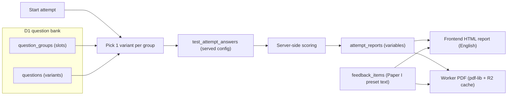

# EDT Test Bank Guide

This document is the source of truth for **question content, scoring models, and CEFR mapping** on the English Diagnostic Test platform. Read it before adding, removing, or remapping MCQs — especially when using an LLM to assist.

For the database schema itself, see [`DATABASE_README.md`](DATABASE_README.md). For UI and branding rules, see [`AGENTS.md`](../AGENTS.md).

**Division of authority with `DATABASE_README.md`:** that document owns the *structures* — the
full `TT-PP-SS-GGG-QQ` code specification, table definitions, the `score_conversion_bands` model
and the band-averaging rule, and the attempts API contract. This document owns the *content* —
which dimensions exist, the actual conversion grids per paper, and the workflows for changing
questions. Where the two touch, this document summarizes and links rather than restating.

---

## 1. Architecture and scope

### The question bank lives in Cloudflare D1

As of schema v4 (migration `0006_unified_test_bank.sql`), MCQ content is stored **in the D1 database** — not in frontend TypeScript files. D1 is the system of record for:

| Content | D1 tables |
|---------|-----------|
| Tests, parts, dimensions | `tests`, `test_parts`, `dimensions` |
| Question groups (exam "slots") and variants | `question_groups`, `questions` |
| Shared passages / audio | `shared_resources` (binaries in R2 `edt-assets`) |
| CEFR / IELTS / TOEFL conversion grids | `score_conversion_bands` |
| Paper I preset report feedback (micro-feedback, area overviews, Part A/B comments) | `feedback_items` |
| Attempts, served variants, answers | `test_attempts`, `test_attempt_answers` |
| Report variables (layout-free) | `attempt_reports` |
| Paper III recordings, transcripts, rubric marks | `test_attempt_answers` (audio / transcript / `ai_mark_json` columns) |
| PDF cache index | `pdf_cache_index` |
| AI feedback + usage accounting | `attempt_reports.ai_*`, `class_overviews`, `ai_api_usage_logs` |

Question content ships as **seed migrations** (`migrations/0007_seed_test1.sql`, `0008_seed_test2.sql`, `0015_seed_test3.sql`, **`0020_paper1_bank_and_feedback.sql`**), generated by scripts:

- `scripts/generate-paper1-seed.mjs` — emits `0020` (hard-replace of the whole Paper I bank **and** its preset report feedback). Stems and options come from `Client_Feedback/test-question-bank/` via `extract-paper1-bank.mjs`; Part A answer keys, grammar-point types and all report comments come from `Client_Feedback/Updated Paper 1 information-Oct2026/` via `extract-paper1-feedback.mjs`. Both use `docx-text.mjs`. The generator validates counts and codes before writing. `generate-test1-seed.mjs` is retired (do not regenerate `0007`). Do not edit `0020` once applied remotely. The same run also writes `0021_paper1_feedback_formatting.sql`: the documents' italics as `*text*` and hyperlinks as `[text](url)` in `feedback_items`, emitted as `UPDATE`s and checked to reduce to the `0020` text when the markup is removed. Both report renderers parse this markup; keep it in any later feedback wording migration.
- `scripts/generate-test2-seed.mjs` — reads `scripts/test2-content.mjs` (transcribed from the client's Paper II docx files).
- `scripts/generate-test3-seed.mjs` — reads `scripts/test3-content.mjs` (Paper III speaking prompts and writing tasks).

> **All three papers are DB-backed** on the attempts API (`worker/src/attempts.ts`): random variant per group (Paper I Part A, Paper II), Part B canonical order for Papers I–II, fixed order for Paper III, served config in `test_attempt_answers`, server-side scoring/marking, `attempt_reports`. Paper I no longer ships `ANSWER_KEY` to the browser and no longer writes `/api/submit`. Candidates pick their paper on the info screen; voucher usage is tracked per test (`voucher_test_usage`, migration `0009`).

### The randomization engine model

Every exam "slot" is a **question group**. Each group holds one or more **variants** (the actual MCQs). Paper I Part A holds 30 per slot; Part B holds 15, 25, 30, 33, or 34. When a user starts a test, the Worker randomly selects **exactly one variant per group** to form their unique test instance, records the served configuration in `test_attempt_answers`, scores server-side against `questions.correct_answer`, and stores layout-free report variables in `attempt_reports`.



Currently Paper I Part A groups hold **30 variants** (`QQ='01'`…`'30'`). Part B groups hold **15, 25, 30, 33, or 34** (`QQ` up to `'34'`). Papers II and III still have **1 variant** (`QQ='01'`). The engine must keep working for any `variant_count` ≥ 1.

---

## 2. Question ID code: `TT-PP-SS-GGG-QQ`

Every variant has a unique `question_code`. **The full specification — segment widths, valid
values per test, and the uniqueness rules — is in
[`DATABASE_README.md` section 2](DATABASE_README.md#2-question-id-business-key-tt-pp-ss-ggg-qq).**
In summary: `TT` test · `PP` part · `SS` dimension or Paper I Part B CEFR area (`01`–`04`; `00` = none on other tests) · `GGG` group (global per test)
· `QQ` variant. Examples: `01-02-02-073-01` = Test 1, Part B, B2, slot 073, variant 01;
`02-01-02-007-01` = Test 2, Part A Listening, C1/C2 item, group 007, variant 01.

The two rules that matter most when authoring content:

- **Score by `question_code` / group identity, never by shuffled display index.**
- Codes are immutable once attempts exist. Add new groups/variants; never renumber or delete — **except** the explicit Paper I hard-replace in migration `0020`, which wipes Paper I attempt history first.

### Feedback ID code: `TT-PP-SS-GGG-QQ-AA`

Paper I preset feedback rows in `feedback_items` are keyed by the question code plus a two-digit
`AA` suffix. Segments set to `00` / `000` mean "not tied to that level".

| Code pattern | `kind` | Meaning |
|--------------|--------|---------|
| `01-01-SS-GGG-QQ-00` | `micro_feedback` | Grammar point for one Part A variant (1,800 rows; `question_id` set; `type_ref` e.g. `A09-T16`; `heading` = grammar point; `fields_json` = `[{label, text}]` rows such as When to use / Look for / Example / Watch out) |
| `01-01-SS-GGG-QQ-01`…`-04` | — | Reserved for option A–D comments (not seeded) |
| `01-01-SS-000-00-AA` | `area_overview` | Area overview for area `SS`: `AA` `01` = 5/5, `02` = 4/5, `03` = 3–2/5, `04` = 1–0/5 (48 rows) |
| `01-01-00-000-00-AA` | `part_a_concluding` | "Moving Forward with Grammar": `AA` `00` = no priority areas, `01` = 1–2, `02` = 3–4, `03` = 5+ (`fields_json` = `{bucket, intro, steps:[{label,text}], closing}`) |
| `01-01-00-000-01-01`…`-03` | `part_a_template` | Strengths intro / strengths closing / roadmap intro (`{n}` = area count, `{areas}` = area/areas) |
| `01-02-00-000-00-AA` | `part_b_placement` | Part B overall comment: `AA` `00` = A2 or below, `01` B1 … `04` C2 |
| `01-02-00-000-01-01`…`-04` | `part_b_additional` | Extra sentence: uneven / close to next band / weaker at the top (`[level]`) / even |
| `01-02-00-000-02-AA` | `part_b_roadmap` | Part B actionable roadmap bullets per placement (`fields_json.bullets`) |

`01-01-00-000-00-00` is therefore the Part A overall comment for zero priority areas and
`01-02-00-000-00-00` the Part B overall comment for an A2-or-below placement. Report variables store
only these codes; the Worker resolves the text from `feedback_items` when it builds the report payload
or the PDF.

---

## 3. Current test models

### Test 1 — Grammar & Vocabulary (`test_code='01'`, status `active`)

| Concept | Value |
|---------|-------|
| Total question groups | **90** (`GGG` 001–090) |
| Part A (`PP='01'`, grammar) | 60 groups, canonical 1–60, `legacy_qid` `A1`–`A60`; 30 variants per group |
| Part B (`PP='02'`, vocabulary) | 30 groups, canonical 61–90, `legacy_qid` `B1`–`B30`; `SS` `01`–`04` |
| Dimensions | **12** grammar dimensions (Part A only), `SS` `01`–`12`, 5 groups each (A–E in order) |
| Part B dimension | none (`dimension_id` NULL). `SS` is the CEFR area: `01` B1, `02` B2, `03` C1, `04` C2. The same band is stored on `question_groups.cefr_level`: **6 B1** (061–066) + **10 B2** (067–076) + **10 C1** (077–086) + **4 C2** (087–090). Variant counts: 061–066 = 30; 067/070/077/080 = 34; 068–069, 071–072, 078–079, 081–082 = 33; 073–076 and 083–086 = 25; 087–090 = 15 |
| Time limit | 3600 s |
| Conversion grids | Part A /60, Part B sequential CEFR placement, overall CEFR ladder with IELTS/TOEFL (tables below; all in `score_conversion_bands`, labels in `level_label`) |
| Band keys | Part A: `a2OrBelow`, `b1`, `b1Plus`, `b2`, `b2Plus`, `c1`, `c1Plus`, `c2` · Part B: `a2OrBelow`, `b1`, `b2`, `c1`, `c2` · Overall: `a2OrBelow`, `b1`, `b1b2`, `b2`, `b2c1`, `c1`, `c1c2`, `c2` |
| Preset feedback | `feedback_items`: 1,800 micro-feedback rows (one per Part A variant) + 48 area overviews + 4 concluding + 3 templates + 5 placement + 4 additional + 5 roadmap = 1,869 rows |
| Serving | Attempts API: one random variant per group; Part A clusters shuffled; Part B canonical order |
| Seed | `0007_seed_test1.sql` (historical 1-variant bank), then **`0020_paper1_bank_and_feedback.sql`** (current bank + feedback). Regenerate with `node scripts/generate-paper1-seed.mjs`. |

Part A dimension slugs (`dimensions.key`) as of `0020` (new rows; do not reuse the retired `tenses` / `activePassive` / … keys with a new meaning): `complexTenses`, `modalsStance`, `adjectiveRelativeClauses`, `nounClausesNominalisation`, `adverbialClausesConnectors`, `conditionalsUnrealistic`, `reportedSpeech`, `gerundsInfinitives`, `subjunctiveFormal`, `inversionFronting`, `participleReducedClauses`, `dependentPrepositions`. Display names follow the Oct 2026 Score Scheme (e.g. "Tenses & Time Expressions", "Prepositions & Common Word Combinations"); English report labels live in `frontend/src/i18n/reportMessages.ts` and `worker/src/reportI18n.ts`.

**Part A /60** (`test_part_id` = Part A):

| Score | CEFR | Label | `band_key` |
|-------|------|-------|------------|
| 0–20 | A2 or below | Foundation | `a2OrBelow` |
| 21–26 | B1 | Intermediate | `b1` |
| 27–32 | B1+ | Intermediate | `b1Plus` |
| 33–38 | B2 | Upper Intermediate | `b2` |
| 39–44 | B2+ | Upper Intermediate | `b2Plus` |
| 45–50 | C1 | Advanced | `c1` |
| 51–55 | C1+ | Advanced | `c1Plus` |
| 56–60 | C2 | Proficient | `c2` |

Plus levels display as "B2+ (Upper Intermediate, upper range)".

**Area labels** (score out of 5 per area, 5 groups A–E): 0–1 Foundation, 2 Emerging, 3 Approaching, 4 Advanced, 5 Proficient (`foundation` … `proficient`). Areas scoring **3 or below are priority areas** (growth roadmap, PRIORITY chip); 4–5 are strengths. Strengths sort by score descending then area number; growth areas by score ascending then area number. Each growth area lists one grammar point per missed item, in A–E order, de-duplicated by `type_ref`.

**Part B placement** (`test_part_id` = Part B; `min_correct` = threshold, `max_correct` = items at that level): B1 needs 4/6, B2 6/10, C1 6/10, C2 3/4. Placement is **sequential** — the highest level whose threshold is met with every lower level also met; if B1 is not met the placement is A2 or below (`min_correct = max_correct = 0`). The report shows each level as a percentage bar only (never item counts). At most one additional sentence is added, in priority order: **uneven** (a higher level met while a lower one is missed) → **close to next band** (one answer short of the next threshold) → **even** (all four percentages within 20 points; skipped for an A2 placement, where it would describe uniformly low scores) → **weaker at the top** (placement B1–C1).

**Overall** (`test_part_id` NULL, `min_correct = max_correct` = ladder step): overall score = raw correct /90 with a percentage. Overall CEFR = `ceil((Part A step + Part B step) / 2)` where Part A steps are the eight Part A bands in order (0–7) and Part B steps are A2 = 0, B1 = 1, B2 = 3, C1 = 5, C2 = 7.

| Step | CEFR | Label | IELTS | TOEFL iBT | `band_key` |
|------|------|-------|-------|-----------|------------|
| 0 | A2 or below | Foundation | ≤ 3.5 | ≤ 41 | `a2OrBelow` |
| 1 | B1 | Intermediate | 4.0–5.0 | 42–71 | `b1` |
| 2 | B1/B2 | Intermediate / Upper Intermediate | 5.0–5.5 | 60–78 | `b1b2` |
| 3 | B2 | Upper Intermediate | 5.5–6.5 | 72–94 | `b2` |
| 4 | B2/C1 | Upper Intermediate / Advanced | 6.5–7.0 | 88–100 | `b2c1` |
| 5 | C1 | Advanced | 7.0–8.0 | 95–113 | `c1` |
| 6 | C1/C2 | Advanced / Proficient | 8.0–8.5 | 110–116 | `c1c2` |
| 7 | C2 | Proficient | 8.5–9.0 | 114–120 | `c2` |

The report always prints the disclaimer: "These correspondences with CEFR, IELTS and TOEFL are approximate and provided for orientation only; they are not official conversions and should not be used as substitutes for the respective tests."

Worked example (the client sample report): Part A 44/60 → B2+ (step 4); Part B 6/6, 10/10, 7/10, 1/4 → C1 (step 5); overall 68/90 (75.6%) → `ceil(4.5)` = 5 → C1, IELTS 7.0–8.0, TOEFL iBT 95–113. `scripts/test-paper1-report.ts` checks this case and the edge cases against the seeded grids.

`0020` is a **hard replace**: it deletes previous Paper I questions/groups/dimensions/bands, Paper I attempts/answers/reports/PDF-cache rows, Paper I class overviews, and all `submissions`; drops `attempt_reports.ai_feedback_zh`; adds `question_groups.cefr_level`, `score_conversion_bands.level_label` and the `feedback_items` table; then inserts the new bank, feedback and grids under the same `test_code='01'` and groups `001`–`090`. It supersedes the earlier local-only drafts of `0020`–`0022`, which were never applied remotely. Production apply requires a D1 backup and destroys live Paper I history; voucher uses are not refunded. Do not run `--remote` without an explicit go-ahead.

Content notes carried over from the client files: the Area 01 "4/5 Strong" overview in *Paper01 Comments in report for PartA(01).docx* repeats the 5/5 text verbatim (seeded as-is; replace via a new migration when the client supplies the 4/5 wording). Five Part A answer keys come from the Oct 2026 MicroFeedback files where they differ from the question-bank docx: `01-01-02-007-13` (B → A), `01-01-02-007-14` (C → B), `01-01-02-007-15` (B → C), `01-01-02-007-29` (C → B) and `01-01-06-030-15` (no key in the bank → C). The generator lists them in the `0020` header.

### Test 2 — Paper II Listening & Reading (`test_code='02'`, status `active`)

| Concept | Value |
|---------|-------|
| Total question groups | **45** (`GGG` 001–045) |
| Part A (`PP='01'`, listening) | 20 groups (Q1–20), each linked to one audio resource |
| Part B (`PP='02'`, reading) | 25 groups (Q21–45), linked to 6 shared passages |
| Dimensions | CEFR difficulty bands per part: `SS='01'` = B2 items, `SS='02'` = C1/C2 items |
| Difficulty tagging | Part A: Q1–6 B2, Q7–20 C1/C2 · Part B: Q21–30 B2, Q31–45 C1/C2 |
| Time limit | 3600 s |
| Audio | R2 `audio/test-02/20260701_NN.mp3`, streamed via authenticated `/api/assets/audio/...`; transcripts stored in `shared_resources.text_content` |
| Passages | 6 `text` resources: narrative (Q21–22), seminar notice (Q23–25), LabelPro (Q26–27), Macrosoft letter (Q28–30), forestry (Q31–37), Creative Commons (Q38–45) |

**Numbering note:** the source docx headed the forestry passage "Questions 31–36" but contains seven stems; the client confirmed Part B has **25 questions numbered 21–45 continuously** (forestry = Q31–37, Creative Commons = Q38–45) and corrected the conversion-notes docx to /25.

Per-part conversion grids (`score_conversion_bands`, from the corrected client conversion notes):

| Part A /20 | Band (`band_key`) | | Part B /25 | Band (`band_key`) |
|------------|-------------------|-|------------|-------------------|
| 0–7 | B1/B1+ (`b1Plus`) | | 0–9 | B1/B1+ (`b1Plus`) |
| 8–11 | Low B2 (`lowB2`) | | 10–13 | Low B2 (`lowB2`) |
| 12–14 | High B2 / Low C1 (`highB2LowC1`) | | 14–16 | High B2 / Low C1 (`highB2LowC1`) |
| 15–17 | C1 (`c1`) | | 17–19 | C1 (`c1`) |
| 18–20 | C1+/C2 (`c1PlusC2`) | | 20–22 | C1+/near C2 (`c1PlusNearC2`) |
| | | | 23–25 | C2 (`c2`) |

The overall level is derived by averaging the two part bands; that rule is specified with the
band model in [`DATABASE_README.md` section 4.11](DATABASE_README.md#411-score_conversion_bands).
Present all mappings as **indicative**, never exact (see the proficiency disclaimer in i18n).

### Test 3 — Paper III Speaking & Writing (`test_code='03'`, status `active`)

| Concept | Value |
|---------|-------|
| Total question groups | **10** (`GGG` 001–010) |
| Part A (`PP='01'`, speaking) | 8 groups; Tasks 1–7 have prompt audio; Task 8 is prep + speak |
| Part B (`PP='02'`, writing) | 2 groups (summary/response + argumentative essay) |
| Dimensions | One skill key per task (immutable) |
| Response types | `question_groups.response_type` = `speaking` \| `writing` |
| Audio prompts | R2 `audio/test-03/Speaking_Prompt_Task_N.mp3` |
| Student recordings | R2 `responses/test-03/{attemptId}/{questionCode}.webm` (metadata only in D1) |
| STT | AssemblyAI verbatim on each upload (webhook + Queue); secret `ASSEMBLYAI_API_KEY` |
| Scoring | DeepSeek rubric JSON marks → CEFR bands `b1b2` / `c1` / `c2`; async `grading_status` |

---

## 4. Feedback and reports

- `attempt_reports.variables` stores **pure variables only** (`rv1` for Papers II/III, `rv3` for Paper I; TypeScript shape in `worker/src/reportVariables.ts`, spec in [`DATABASE_README.md`](DATABASE_README.md) section 7). No HTML, no layout, no locale-baked narrative text. Paper I variables hold scores, band refs, area label keys, priority flags, missed question codes and feedback codes — never feedback text.
- **Reports are English-only** (HTML, PDF and AI feedback). Labels come from `frontend/src/i18n/reportMessages.ts` (shared by both site locales) and `worker/src/reportI18n.ts`. The rest of the site UI stays bilingual (EN + zh-HK in `messages.ts`).
- Paper I preset text is resolved from `feedback_items` by code at render time: the attempts API returns it as `feedback` alongside `variables`, and the PDF renderer loads it directly (`loadPaper1Feedback` in `worker/src/paper1Report.ts`). Edit the wording with a new migration that updates `feedback_items`; no code change is needed.
- Reports show **no questions or answer review**, and **no cohort, percentile or peer ranking**. Candidate payloads always carry `review: []`; only the teacher Paper III view receives the candidate's own recordings, transcripts and essays (never MCQ keys).
- PDF download: `GET /api/reports/:attemptId/pdf` (`worker/src/reports.ts`) — pdf-lib render, EDT-branded, A4, measured layout that keeps headings with their content and splits grammar-point cards only between rows; written at submit and kept in R2 for 24 hours after the attempt ends (410 after that). Auth: voucher retrieval pair, owning session (including 24 hours after submit), or teacher key scoped by `user_group`.
- Per-question outcomes live in `test_attempt_answers`, not in the report JSON.

---

## 5. File touchpoint matrix

Update **every** relevant row when content or scoring models change.

| Change | Touchpoints |
|--------|-------------|
| Edit a Test 1 MCQ | New D1 migration updating `questions` (never edit `0020` once applied). Regenerate via `scripts/generate-paper1-seed.mjs` only when replacing the whole Paper I bank in a new migration |
| Edit Paper I report wording | New D1 migration updating `feedback_items` by `feedback_code` (keep codes and `type_ref` stable). Section labels/headings live in `frontend/src/i18n/reportMessages.ts` + `worker/src/reportI18n.ts` (English only) |
| Add Part A variants | Every new Part A variant needs its own `feedback_items` row `TT-PP-SS-GGG-QQ-00` (`kind='micro_feedback'`, `question_id` set) or its grammar point will be missing from the roadmap |
| Edit a Test 2 MCQ / transcript / passage | `scripts/test2-content.mjs` + new D1 migration updating the affected rows |
| Add variants to a group | New migration inserting `questions` rows (`QQ` next free, `UNIQUE(question_group_id, variant_code)`), update `question_groups.variant_count` |
| Add a new audio/text resource | `shared_resources` row + R2 upload via `scripts/upload-assets.ps1`; `content_url` must be an `/api/assets/...` route |
| Change dimensions | `dimensions` table; keep `key` stable (history). Paper I grammar keys were replaced in `0020` (old rows deleted). Also update the English labels in `reportMessages.ts` / `reportI18n.ts` and the slot map in `frontend/src/data/dimensions.ts` |
| Change conversion bands | `score_conversion_bands` migration; keep `band_key` stable. The teacher dashboard reads Paper I dimensions and Part A buckets from D1. Paper I thresholds and ladder steps are also encoded in `worker/src/paper1Report.ts` (Part B order, ladder mapping) — keep them in step and rerun `scripts/test-paper1-report.ts` |
| New test | `tests` + parts + dimensions + groups + variants + bands seed migration; status `draft` until UI ships |
| Report variable shape | Bump `report_version`, update `worker/src/reportVariables.ts`, `frontend/src/types.ts`, both renderers, and the PDF `pdfLayout` constant |
| User-visible counts / copy | `frontend/src/i18n/messages.ts` (EN **and** zh-HK), `USER_GUIDE.md`. Report copy is English-only (`reportMessages.ts`, `reportI18n.ts`) |

### Legacy duplication warning

`frontend/src/data/questions.ts` no longer holds the Paper I bank or `ANSWER_KEY`. `dimensions.ts` still lists the 12 grammar keys and A1–A60 / B1–B30 slot maps for teacher-dashboard helpers. The teacher dashboard in `worker/src/index.ts` aggregates completed Paper I **attempts** from `attempt_reports` (rv3 `paper1` block) and reads its dimension list and Part A buckets from D1. `/api/submit` returns 410.

---

## 6. Invariants checklist

Run before merging any test-bank change (SQL against D1):

- [ ] Every `question_code` matches `TT-PP-SS-GGG-QQ` (15 chars, 4 dashes) and is UNIQUE
- [ ] `TT` = `tests.test_code`, `GGG` = `question_groups.group_code`, `SS` = linked `dimensions.dimension_code` for every variant that has a dimension. Paper I Part B is the exception: `dimension_id` IS NULL and `SS` is `01`–`04` (B1, B2, C1, C2), matching `question_groups.cefr_level`
- [ ] `UNIQUE(test_id, group_code)` and `UNIQUE(question_group_id, variant_code)` hold; `variant_count` = actual variant rows per group
- [ ] MCQ groups (`response_type='mcq'`, Tests 1–2): `correct_answer` ∈ {A, B, C, D}; exactly four non-empty options per variant
- [ ] Test 1: 12 dimensions × 5 groups; 90 groups; 2,640 variants (Part A 1,800 + Part B 840); Part B `cefr_level` counts 6 B1 + 10 B2 + 10 C1 + 4 C2; `variant_count` ≥ 1; `legacy_qid` set
- [ ] Test 1 feedback: every Part A variant has exactly one `feedback_items` row `question_code || '-00'` with `kind='micro_feedback'`, matching `question_id`, non-empty `type_ref` and `heading`; 48 `area_overview` rows (12 areas × 4 bands); 4 `part_a_concluding`, 3 `part_a_template`, 5 `part_b_placement`, 4 `part_b_additional`, 5 `part_b_roadmap`; every `feedback_code` matches `TT-PP-SS-GGG-QQ-AA`
- [ ] Test 1 bands: 8 Part A rows covering 0–60, 5 Part B rows (thresholds 4/6, 6/10, 6/10, 3/4 plus `a2OrBelow`), 8 overall ladder rows (steps 0–7, IELTS/TOEFL set) with `level_label` on every row
- [ ] Test 2: every listening group has an audio resource; every reading group has a passage; audio `content_url` points to `/api/assets/audio/...` (never a public URL)
- [ ] Test 3: 10 groups; `response_type` is `speaking` (8) or `writing` (2); every speaking task that needs prompt audio has a resource under `audio/test-03/`; a rubric exists in `worker/src/paper3Rubrics.ts` for every task
- [ ] Conversion bands per (test, part) cover 0…total contiguously with no overlap; top `max_correct` = group count of scope (exempt: rubric-graded Test 3, whose bands come from `ai_band_key`, and Paper I Part B / overall, whose rows are thresholds and ladder steps)
- [ ] `dimensions.key` and `score_conversion_bands.band_key` unchanged for existing rows (history compatibility). Paper I grammar keys were replaced only in `0020`.
- [ ] EN and zh-HK UI strings updated for any user-visible site change (`messages.ts`); report strings are English-only (`reportMessages.ts` + `worker/src/reportI18n.ts`)
- [ ] `npx tsx scripts/test-paper1-report.ts` passes after any Paper I scoring or band change
- [ ] New content shipped as a **new** migration — applied migrations are never edited

---

## 7. Workflows

### Workflow A — Edit an existing variant's text or answer

1. Write a new migration (`migrations/00NN_fix_....sql`) with `UPDATE questions SET ... WHERE question_code = '...'`.
2. If Test 2: also update `scripts/test2-content.mjs` so regeneration stays faithful.
3. Apply local → verify with the invariants checklist → apply remote (`npx wrangler d1 migrations apply edt-diagnostic --local|--remote`). **Do not apply `0020` remotely without a backup.**
4. If the Part A answer changes, check that the variant's micro-feedback row (`…-00`) still explains the new correct answer; update it in the same migration.

### Workflow B — Author additional variants (target: 10 per group)

1. Draft variants matching the group's dimension/difficulty and, for Test 2, the same shared resource.
2. New migration inserting `questions` rows: next `variant_code` (`02`…`10`), `question_code` with the same `TT-PP-SS-GGG` prefix.
3. Update `question_groups.variant_count`.
4. For Paper I Part A, insert the matching `feedback_items` micro-feedback row (`…-00`) for each new variant.
5. Never delete or renumber existing variants that have been served (they are referenced by `test_attempt_answers`), except the Paper I wipe in `0020`.

### Workflow C — Add a new test

1. Back up remote D1 first (`wrangler d1 export ... --output db_backup/...`).
2. Seed migration: `tests` (next `test_code`), `test_parts`, `dimensions`, `shared_resources` (+ R2 uploads), `question_groups`, `questions`, `score_conversion_bands`.
3. Status `draft` until its UI ships; the randomization engine and PDF service are content-agnostic.
4. Add English report labels for any new `band_key`s (`reportMessages.ts` + `worker/src/reportI18n.ts`).

### Workflow D — Paper I history (superseded by `0020`)

Migration `0020` **deletes** live Paper I attempts, answers, reports, PDF cache rows, class overviews, and all `submissions`. The new bank reuses groups `001`–`090` with different items, so old Paper I scores cannot be rebound. The pre-restructure export `db_backup/edt-diagnostic-20260707.sql` remains a snapshot of the *previous* bank and scoring model; do not map it onto the post-`0020` groups. New sits live in `test_attempts` / `attempt_reports` (rv3).

---

## 8. LLM agent instructions

1. **Read this file and [`DATABASE_README.md`](DATABASE_README.md) first** before touching test content.
2. **Never score by display index** — use `question_code` / stable group identity.
3. **Never hardcode variant selection** — the engine picks one random variant per group at attempt start; the served variant is recorded in `test_attempt_answers`.
4. **Ship content changes as new D1 migrations**; never edit applied migrations; regenerate seeds only for fresh databases.
5. **Keep `dimensions.key` and `band_key` values stable** — stored history and narrative i18n key off them. Paper I grammar keys were replaced only in `0020`.
6. **Never store layout, HTML, or locale-rendered text in `attempt_reports.variables`** — variables and feedback codes only; Paper I text resolves from `feedback_items`, labels from the report dictionaries, at render time.
7. **Never expose R2 audio publicly** — only through the authenticated `/api/assets/audio/...` route.
8. **Update EN and zh-HK together for site UI** (`messages.ts`). Reports are English-only — do not reintroduce a zh-HK report locale, cohort/percentile figures, or question review.
9. **Do not ship `ANSWER_KEY` or the full Paper I bank to the browser.** Score Paper I on `/api/attempts`.
10. **Run the invariants checklist** (section 6) and list every file/table touched in the PR description.

---

## 9. Quick reference — primary sources

| Question | Authority |
|----------|-----------|
| Schema, ID spec, attempts API contract, report variables, PDF/cache protocol | [`DATABASE_README.md`](DATABASE_README.md) |
| Dimensions, conversion grids, content workflows | this document |
| Publish, migrate, upload assets, secrets, local preview | [`PUBLISH_UI.md`](PUBLISH_UI.md) |
| Candidate / teacher / admin behaviour | [`USER_GUIDE.md`](USER_GUIDE.md) |
| UI tokens and branding rules | [`AGENTS.md`](../AGENTS.md) |
| Completed one-time rollouts | [`HISTORY.md`](HISTORY.md) |

---

## 10. Repository file map (canonical)

This is the **single canonical file map** for the repository; `README.md` links here rather than
keeping its own copy. Update it whenever files are added, renamed, or removed.

```
README.md                        ← orientation + pointers
AGENTS.md                        ← design system + agent rules (must stay at repo root)
docs/                            ← DATABASE_README, TEST_BANK_GUIDE, PUBLISH_UI, USER_GUIDE, HISTORY
wrangler.toml                    ← production Worker config (D1 + R2 + queue bindings, SPA assets)

migrations/                      ← D1 migrations; never edit an applied one
  0001_init.sql .. 0005_voucher_uses_allowed.sql
                                 ← legacy tables: vouchers, sessions, submissions,
                                   teacher_credentials, voucher metadata / uses_allowed
  0006_unified_test_bank.sql     ← 12-table unified schema
  0007_seed_test1.sql            ← Test 1 content (generated)
  0008_seed_test2.sql            ← Test 2 content (generated)
  0009_voucher_test_usage.sql    ← per-test voucher usage
  0010_activate_test2.sql        ← Paper II activation
  0011_attempt_answer_display_order.sql
                                 ← display_order on test_attempt_answers
  0012_ai_feedback.sql           ← attempt_reports.ai_*, teacher AI quota, class_overviews
  0013_ai_usage_log.sql          ← ai_api_usage_logs (admin spend view)
  0014_paper3_schema.sql         ← response_type; audio/transcript/ai_mark columns; grading_status
  0015_seed_test3.sql            ← Test 3 content: 8 speaking + 2 writing (generated)
  0016_activate_test3.sql        ← Paper III activation
  0017_class_overviews_test_code.sql
                                 ← per-paper scoping for class overviews
  0018_paper3_prompt_copy.sql    ← Paper III prompt wording
  0019_paper3_prompt_recording_copy.sql
                                 ← Paper III recording instruction wording
  0020_paper1_bank_and_feedback.sql
                                 ← Oct 2026 Paper I bank + feedback_items + grids (generated;
                                   destructive hard-replace of Paper I)
  0021_paper1_feedback_formatting.sql
                                 ← italics / word-list links in feedback_items
  0022_paper1_speaker_b_newline.sql
                                 ← Speaker B on its own line; 24-hour PDF cache expiry

scripts/
  local-preview.ps1              ← one-click local dev (D1 + R2 + vouchers + servers); local-only
  publish-ui.ps1                 ← build, commit, push (Cloudflare deploys)
  migrate-remote-db.ps1          ← backup + apply migrations to remote D1 + verify counts
  upload-assets.ps1              ← R2 uploads: Paper II/III audio + PDF fonts
  docx-text.mjs                  ← ZIP/XML paragraph + table extractor
  extract-paper1-bank.mjs        ← parse the Client_Feedback Paper I question bank (read-only)
  extract-paper1-feedback.mjs    ← parse the Oct 2026 MicroFeedback + comment docx files (read-only)
  generate-paper1-seed.mjs       ← emits 0020 (bank + feedback + grids) with validation
  test-paper1-report.ts          ← rv3 builder checks: sample report + edge cases vs seeded grids
  generate-test1-seed.mjs        ← retired stub (throws; do not regenerate 0007)
  test2-content.mjs              ← Test 2 content source (transcribed from docx)
  generate-test2-seed.mjs        ← Test 2 seed generator
  test3-content.mjs              ← Test 3 content source (speaking prompts + writing tasks)
  generate-test3-seed.mjs        ← Test 3 seed generator

worker/src/
  index.ts                       ← routes; voucher/session; teacher dashboard (Paper I attempts)
  attempts.ts                    ← attempts API: variant serving, server scoring, reports (Papers I–III)
  paper1Report.ts                ← Paper I rv3 builder (bands, areas, Part B placement, ladder)
                                   + feedback_items loader
  assets.ts                      ← authenticated audio / response streaming (R2)
  reports.ts                     ← server-side PDF (English) + 24-hour cache
  reportVariables.ts             ← rv1 (II/III) / rv3 (Paper I) report variables schema
  reportI18n.ts                  ← PDF labels (English only)
  admin.ts                       ← admin API: vouchers, teacher credentials, AI usage
  paper3Routes.ts                ← Paper III audio upload + AssemblyAI webhook
  paper3Assembly.ts              ← AssemblyAI STT (webhook or queue polling)
  paper3Grading.ts               ← Queue consumer: DeepSeek rubric marking
  paper3Rubrics.ts               ← per-task speaking / writing rubrics
  paper3Prompt.ts                ← Paper III prompt assembly
  aiFeedback.ts                  ← student feedback + teacher class overviews (DeepSeek)
  aiPrompts.ts / aiKnowledge.ts  ← prompt templates + reference material
  aiUsageLog.ts                  ← AI call/cost accounting

frontend/src/
  data/                          ← Paper I dimension slot maps + MCQ types (no ANSWER_KEY)
  screens/QuizScreen.tsx         ← Paper I quiz (attempts API)
  screens/ResultsScreen.tsx      ← Paper I report shell (sections + AI feedback + server PDF)
  components/Paper1Report.tsx    ← Paper I report sections (summary, mastery, strengths,
                                   roadmap, concluding, vocabulary)
  components/MasteryBar.tsx      ← segmented percentage bar (Part A areas, Part B levels)
  lib/paper1Report.ts            ← Paper I level labels, template fill, grammar-point helpers
  screens/Test2QuizScreen.tsx    ← Paper II quiz (sound check, audio once-only, passage viewer)
  screens/Test2ResultsScreen.tsx ← Paper II report (part bands, difficulty bars, server PDF)
  screens/Test3QuizScreen.tsx    ← Paper III (mic/speaker gate, one-shot recording, writing)
  screens/Test3ResultsScreen.tsx ← Paper III report (task cards, playback, essays, AI marks)
  screens/InfoScreen.tsx         ← candidate info + paper picker (remaining uses per paper)
  screens/TeacherDashboardScreen.tsx / AdminScreen.tsx
  components/AudioOncePlayer.tsx ← once-only listening clip player
  components/PassageViewer.tsx   ← scrollable passage container (remounts per passage)
  i18n/messages.ts               ← EN + zh-HK UI strings (counts, copy)
  i18n/reportMessages.ts         ← English-only report strings shared by both locales

db_backup/                       ← D1 exports (gitignored); edt-diagnostic-20260707.sql is the
                                   preserved pre-restructure snapshot (previous Paper I bank)
```
